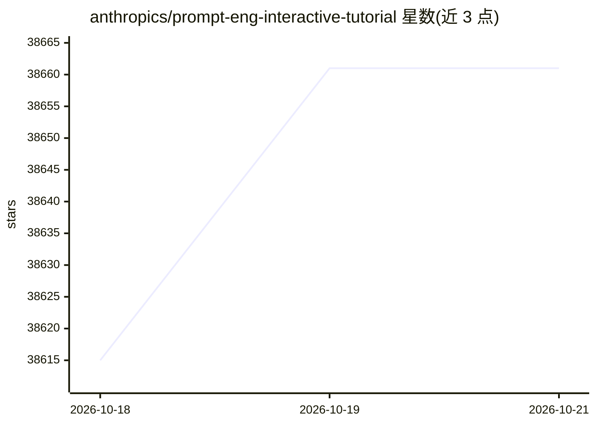

# anthropics/prompt-eng-interactive-tutorial

⭐ 38,661 · Jupyter Notebook · 推送 2026-08-28 · [GitHub](https://github.com/anthropics/prompt-eng-interactive-tutorial) · 组织维护

**面向开发者的 Claude 提示词工程交互式教程**

Anthropic 官方的提示词工程交互式课程，共 9 章（初级到高级）加附录，每章配练习与答案，按章节顺序学习。每节课末尾提供 Example Playground，可修改提示词并观察 Claude 响应变化；示例使用 Claude 3 Haiku 模型，另提供基于 Claude for Sheets 扩展的 Google Sheets 版本。内容覆盖提示词结构、消除幻觉、思维链、示例使用及法律/金融/编码等行业用例。

## 筛选速览

| 维度 | 判定 | 备注 |
|---|---|---|
| AI 角色 | `ai-knowledge` | 知识聚合/清单类 |
| 许可风险 | `none` | — |
| 部署形态 | `None` |  |
| 模型依赖 | locked-api |  |
| 硬件要求 | — | 无带数字的原话,不猜 |
| 安装摩擦 | `low` | 无编译、无系统依赖或容器化 |
| 成熟度 | — | 结构信号不足 |

## 动量与使用信号

- 维护:`active` — 距上次 push 51.1 天,年发版 0,2 位贡献者
- 涨星:近 1 天 **+17**(自 20261016 起算)
- 安装:github 包 `release-assets` 月下载无数据

## 能力要点

- 9 章分级课程，每章配练习与答案
- 每课附带 Example Playground 供实验
- 行业用例章节含法律、金融、编码复杂提示练习
- 附录覆盖提示链、工具使用、检索

## 适用场景

- 从头学习 Claude 提示词的编写与调试
- 为客服机器人、法律、金融等场景构建复杂提示
- 了解常见提示失效模式及应对方法

## 场景标签

`提示工程` `教程课程` · 领域:Agent 开发

## 证据(README 行号)

> L1: # Welcome to Anthropic's Prompt Engineering Interactive Tutorial
> L19: Note: This tutorial uses our smallest, fastest, and cheapest model, Claude 3 Haiku. Anthropic has two other models,

## 星数曲线

2026-10-18 38,615 → 2026-10-21 38,661（+46）

---
*卡片 v1 · prompt 1.4 · 生成 2026-10-18 · 置信度 high · 依据 README sha `9fb028bf0092` · [字段定义](../../DATASET.md)*
