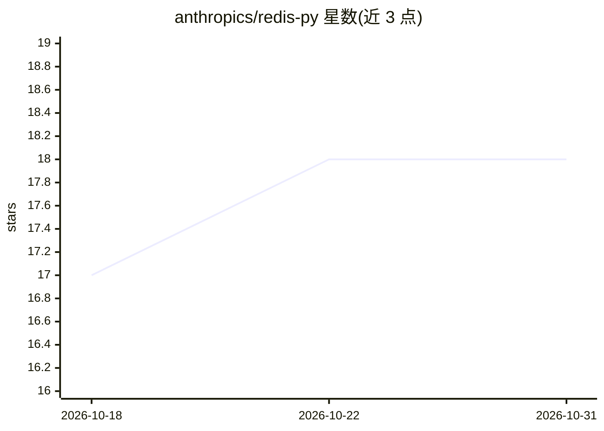

# anthropics/redis-py

⭐ 18 · Python · MIT · 推送 2025-11-24 · [GitHub](https://github.com/anthropics/redis-py) · 组织维护

**Redis 键值存储的官方 Python 客户端库**

Redis Inc. 维护的 Python 接口库，连接 Redis 服务器并执行其命令：覆盖全部内置命令，支持 RESP3 协议、连接池、异步与集群连接、Pipelines 批量执行和 PubSub 订阅。可选安装 hiredis 编译响应解析器提升性能且无需改代码。通过 pip 发布于 PyPI，兼容 Redis 5.0 至 7.4，需 Python 3.8+。文档含基础示例与进阶主题说明。

## 筛选速览

| 维度 | 判定 | 备注 |
|---|---|---|
| AI 角色 | `ai-ecosystem` | LLM/agent 周边工具 |
| 许可风险 | `permissive` | MIT |
| 部署形态 | `self-host` | docker 或自建部署 |
| 模型依赖 | — | README 未给出锁定关系 |
| 硬件要求 | — | 无带数字的原话,不猜 |
| 安装摩擦 | `low` | 无编译、无系统依赖或容器化 |
| 成熟度 | — | 结构信号不足 |

## 能力要点

- 覆盖全部 Redis 内置命令，遵循官方命令语法
- 支持 RESP3 协议、连接池、异步/集群连接
- Pipelines 批量执行与 PubSub 订阅模式
- 可选 hiredis 编译解析器，零代码改动

## 适用场景

- Python 应用中读写 Redis 缓存数据
- 通过 Pipeline 批量执行命令减少往返
- 订阅 Redis Pub/Sub 频道处理消息

## 场景标签

 · 领域:数据库客户端/中间件

## 证据(README 行号)

> L3: The Python interface to the Redis key-value store.
> L150: redis-py is developed and maintained by Redis Inc. It can be found [here](

## 星数曲线

2026-10-18 17 → 2026-10-31 18（+1）

---
*卡片 v1 · prompt 1.4 · 生成 2026-10-29 · 置信度 mid · 依据 README sha `8402ac87a74c` · [字段定义](../../DATASET.md)*
