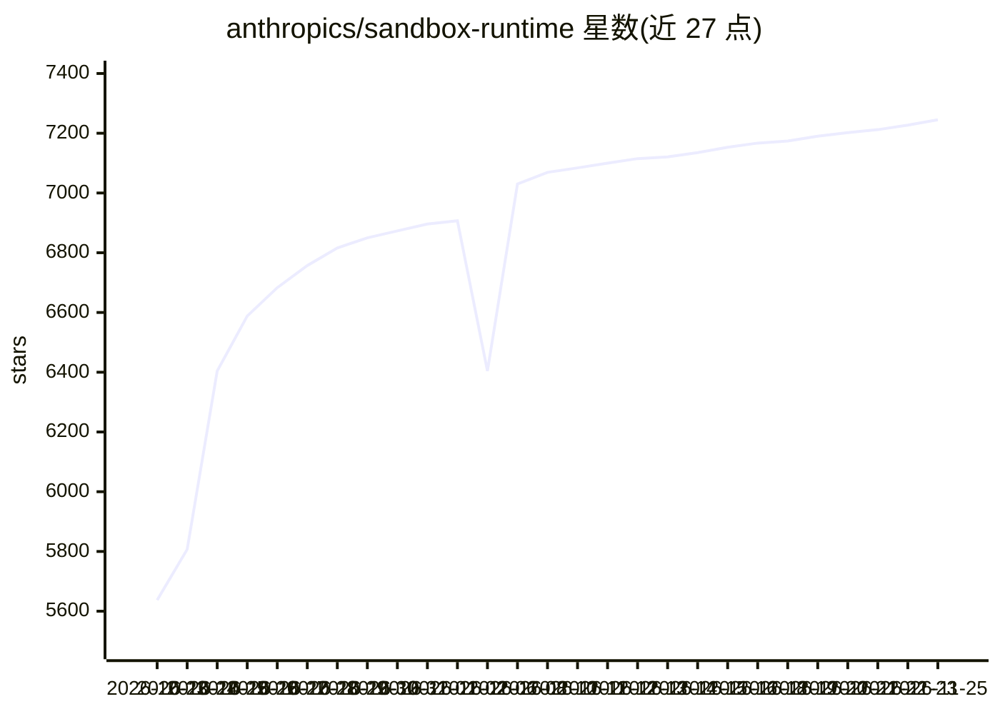

# anthropics/sandbox-runtime

⭐ 7,245 · TypeScript · Apache-2.0 · 推送 2026-11-13 · [GitHub](https://github.com/anthropics/sandbox-runtime) · 组织维护

**为 AI Agent 等进程加 OS 级文件与网络隔离的沙箱工具**

Anthropic 发布的独立沙箱工具，可作 CLI、代理或 TypeScript 库使用。调用各平台原生原语（macOS sandbox-exec、Linux bubblewrap、Windows 专用账户+WFP 过滤）对任意进程施加文件系统读/写规则与网络域名白名单，流量经 HTTP/SOCKS5 代理中介。典型用途是沙箱化 Agent、本地 MCP 服务器和 bash 命令。为 Claude Code 的研究预览而开发，API 与配置格式可能演进；支持运行中通过 --control-fd 更新配置。

## 筛选速览

| 维度 | 判定 | 备注 |
|---|---|---|
| AI 角色 | `ai-ecosystem` | LLM/agent 周边工具 |
| 许可风险 | `permissive` | Apache-2.0 |
| 部署形态 | `desktop` | 安装包/桌面程序 |
| 模型依赖 | — | README 未给出锁定关系 |
| 硬件要求 | — | 无带数字的原话,不猜 |
| 安装摩擦 | `high` | 编译与系统依赖俱全 |
| 成熟度 | `idea` | |

## 能力要点

- CLI、独立代理（srt proxy）与库三种使用方式
- 三平台原生沙箱原语：sandbox-exec/bubblewrap/Windows WFP
- 网络流量经 HTTP 与 SOCKS5 代理按域名白名单中介
- --control-fd 支持运行中整配置热更新

## 适用场景

- 沙箱化本地 MCP 服务器限制其文件与网络访问
- 让 Claude Code 等 Agent 在受限环境中执行 bash 命令
- 为在本机运行的任意进程施加最小权限网络白名单

## 场景标签

 · 领域:AI Agent 安全基础设施

## 证据(README 行号)

> L5: `srt` uses native OS sandboxing primitives (`sandbox-exec` on macOS, `bubblewrap` on Linux) and proxy-based network 
> L9: > The Sandbox Runtime is a research preview developed for Claude Code to enable safer AI agents. It's being made ava

## 星数曲线

2026-10-23 5,637 → 2026-11-25 7,245（+1,608）

---
*卡片 v1 · prompt 1.4 · 生成 2026-11-22 · 置信度 mid · 依据 README sha `1c8b6c24dbc4` · [字段定义](../../DATASET.md)*
