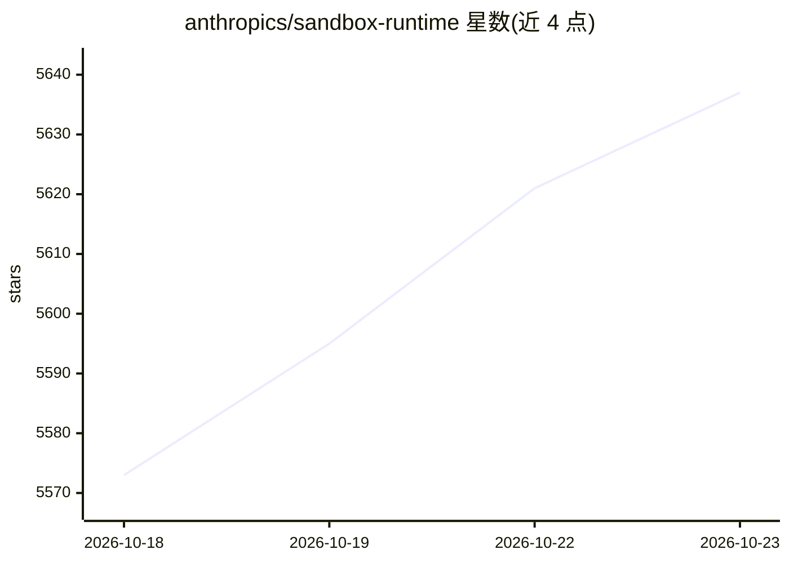

# anthropics/sandbox-runtime

⭐ 5,637 · TypeScript · Apache-2.0 · 推送 2026-10-22 · [GitHub](https://github.com/anthropics/sandbox-runtime) · 组织维护

**给开发者的进程级沙箱：限制任意进程的文件与网络访问**

Anthropic 开源的轻量沙箱工具（srt），以 CLI 与 TypeScript 库形式提供，通过原生 OS 沙箱原语（macOS 的 sandbox-exec/Seatbelt、Linux 的 bubblewrap、Windows 的专用账户与 WFP 过滤）对任意进程施加文件系统与网络限制，无需容器。网络流量经主机侧 HTTP/SOCKS5 代理按域名允许列表过滤。面向 AI agent、MCP 服务器、bash 命令的隔离运行场景，为 Claude Code 研究预览的一部分，API 与配置格式可能变化。

## 筛选速览

| 维度 | 判定 | 备注 |
|---|---|---|
| AI 角色 | `ai-ecosystem` | LLM/agent 周边工具 |
| 许可风险 | `permissive` | Apache-2.0 |
| 部署形态 | `desktop` | 安装包/桌面程序 |
| 模型依赖 | locked-api |  |
| 硬件要求 | — | 无带数字的原话,不猜 |
| 安装摩擦 | `medium` | 含编译或系统依赖之一 |
| 成熟度 | `idea` | |

## 能力要点

- macOS/Linux/Windows 三平台原生 OS 级沙箱实现，无需容器
- 文件系统读写限制（默认拒写、域名白名单式网络隔离）
- 支持沙箱化 MCP 服务器配置
- 提供 CLI、库与独立代理（srt proxy）三种使用方式

## 适用场景

- 限制 AI agent 或 MCP 服务器可读写的文件与可访问的域名
- 安全运行不可信的 bash 命令或任意子进程
- 审计沙箱违规（违规日志与归因）

## 场景标签

 · 领域:AI 安全/系统工具

## 证据(README 行号)

> L5: `srt` uses native OS sandboxing primitives (`sandbox-exec` on macOS, `bubblewrap` on Linux) and proxy-based network 
> L9: > The Sandbox Runtime is a research preview developed for Claude Code to enable safer AI agents. It's being made ava
> L39: A key use case is sandboxing Model Context Protocol (MCP) servers to restrict their capabilities. For example, to s

## 星数曲线

2026-10-18 5,573 → 2026-10-23 5,637（+64）

---
*卡片 v1 · prompt 1.4 · 生成 2026-10-20 · 置信度 mid · 依据 README sha `0ac846a581a0` · [字段定义](../../DATASET.md)*
