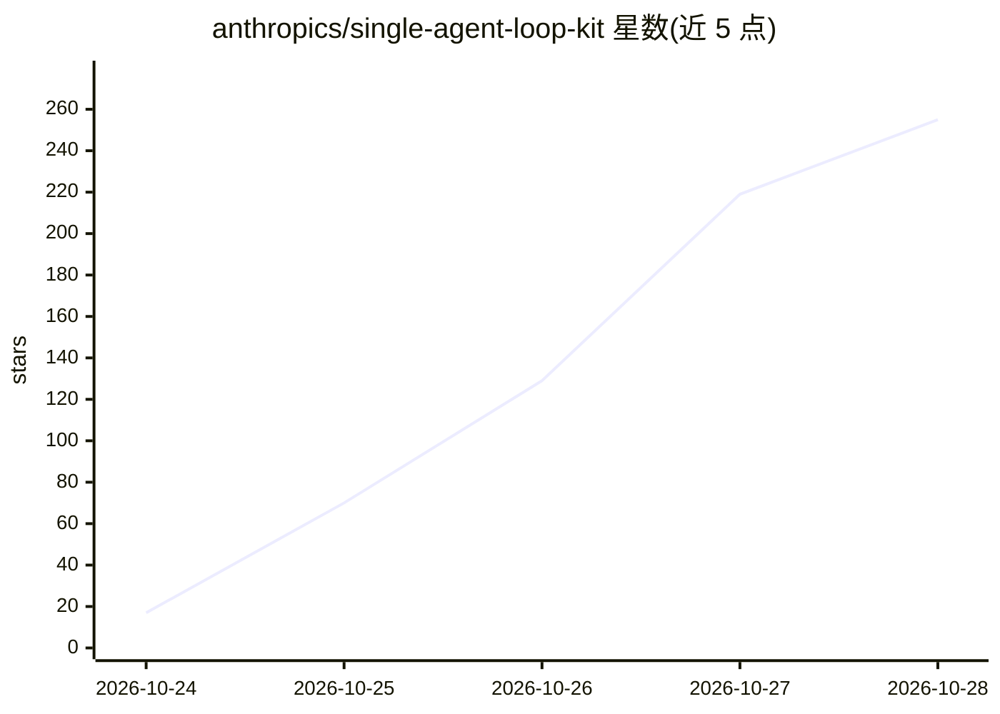

# anthropics/single-agent-loop-kit

⭐ 313 · Python · Apache-2.0 · 推送 2026-10-21 · [GitHub](https://github.com/anthropics/single-agent-loop-kit) · 组织维护

**把多 agent 系统收敛为单循环的 Claude Code 技能工具包**

由 Anthropic 以参考实现形式发布的技能包：配合 Claude Code 使用，先盘点仓库中的子 agent 并给出 fold/merge/call as tool/keep 判定，再逐项变更并用前后同一评测打分比较；无评测时会协助起草约十个任务建立基线。附带可离线冒烟运行的支持台示例、参考单循环实现与耦合分析、成本对比等脚本。声明不维护、不接受贡献，merge/upkeep 等步骤未经真实模型运行验证。

## 筛选速览

| 维度 | 判定 | 备注 |
|---|---|---|
| AI 角色 | `ai-ecosystem` | LLM/agent 周边工具 |
| 许可风险 | `permissive` | Apache-2.0 |
| 部署形态 | `None` |  |
| 模型依赖 | — | README 未给出锁定关系 |
| 硬件要求 | — | 无带数字的原话,不猜 |
| 安装摩擦 | `low` | 无编译、无系统依赖或容器化 |
| 成熟度 | `idea` | |

## 能力要点

- 审计子 agent 并给出 fold/merge/tool/keep 四类判定
- 每次变更前后用同一 eval 打分比较
- 免费离线冒烟检查无需 API key
- 附参考单循环实现（并行工具批、按需技能、预算、写门）

## 适用场景

- 把路由器+子 agent 架构收敛为单 agent 循环
- 为尚无评测的 agent 系统建立可打分基线
- 量化对比子 agent 折叠前后的任务完成率与成本

## 场景标签

`Agent 框架` `模型评测` · 领域:Agent 开发

## 证据(README 行号)

> L3: A starter kit for moving a multi-agent system (a router or orchestrator in front of
> L53: 2. Open Claude Code in your agent repo and say: `Run the single-agent-loop skill.`
> L92: The steps hand off to these Claude Code commands instead of rebuilding them:

## 星数曲线

2026-10-24 17 → 2026-10-28 255（+238）

---
*卡片 v1 · prompt 1.4 · 生成 2026-10-24 · 置信度 high · 依据 README sha `8ec43039ba06` · [字段定义](../../DATASET.md)*
