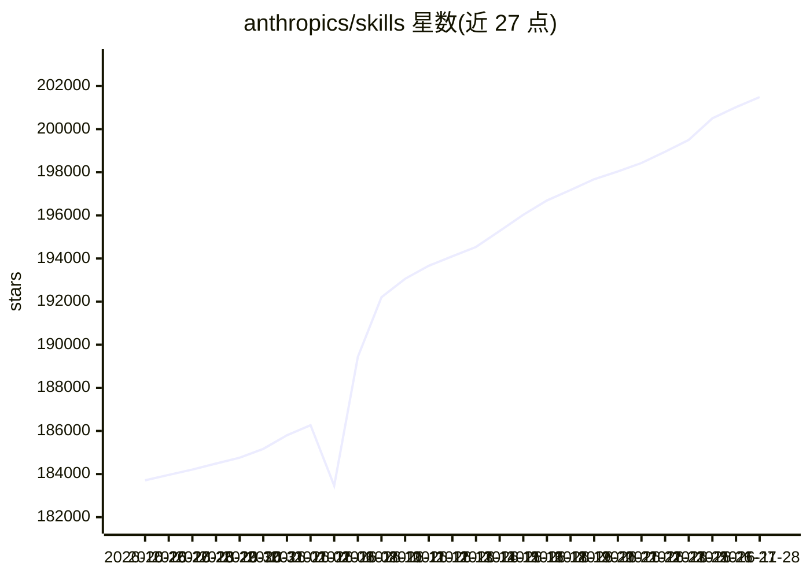

# anthropics/skills

⭐ 201,485 · Python · 推送 2026-11-16 · [GitHub](https://github.com/anthropics/skills) · 组织维护

**Anthropic 官方 Agent Skills 示例、规范与模板集合**

Anthropic 维护的 Claude Agent Skills 仓库：skills 是包含 SKILL.md（YAML frontmatter+指令）的文件夹，Claude 动态加载以完成品牌文档创建、数据分析、MCP server 生成等专项任务。仓库含四类示例技能（创意设计、开发技术、企业沟通、文档技能 docx/pdf/pptx/xlsx）、Agent Skills 规范与技能模板。多数技能 Apache 2.0 开源；声明仅作演示与教学用途，需自行充分测试。可在 Claude Code 插件市场注册安装，付费版 Claude.ai 已内置，也可经 Claude API 上传。

## 筛选速览

| 维度 | 判定 | 备注 |
|---|---|---|
| AI 角色 | `ai-knowledge` | 知识聚合/清单类 |
| 许可风险 | `none` | — |
| 部署形态 | `None` |  |
| 模型依赖 | locked-api |  |
| 硬件要求 | — | 无带数字的原话,不猜 |
| 安装摩擦 | `low` | 无编译、无系统依赖或容器化 |
| 成熟度 | — | 结构信号不足 |

## 动量与使用信号

- 维护:`active` — 距上次 push 8.5 天,年发版 0,15 位贡献者
- 涨星:近 1 天 **+264**(自 20261016 起算)
- 安装:github 包 `release-assets` 月下载无数据
- 平台:— · 协议:MCP

## 能力要点

- SKILL.md 格式（name+description 两个必填字段）的自包含技能文件夹
- 内置驱动 Claude 文档能力的 docx/pdf/pptx/xlsx 技能作为生产参考实现
- 含 Agent Skills 规范（./spec）与技能创建模板（./template）
- 支持 Claude Code 插件市场、Claude.ai 与 Claude API 三种使用途径

## 适用场景

- 在 Claude Code 中安装文档技能处理 PDF/docx 等文件
- 参考示例技能编写自己的自定义技能
- 为公司品牌规范、数据流程编写可复用的任务指令包

## 场景标签

`Agent 框架` · 领域:Agent 开发

## 证据(README 行号)

> L1: > **Note:** This repository contains Anthropic's implementation of skills for Claude. For information about the Agen
> L18: Each skill is self-contained in its own folder with a `SKILL.md` file containing the instructions and metadata that
> L28: - ./spec: The Agent Skills specification

## 星数曲线

2026-10-26 183,710 → 2026-11-28 201,485（+17,775）

---
*卡片 v1 · prompt 1.4 · 生成 2026-11-22 · 置信度 high · 依据 README sha `2a99fc86af74` · [字段定义](../../DATASET.md)*
