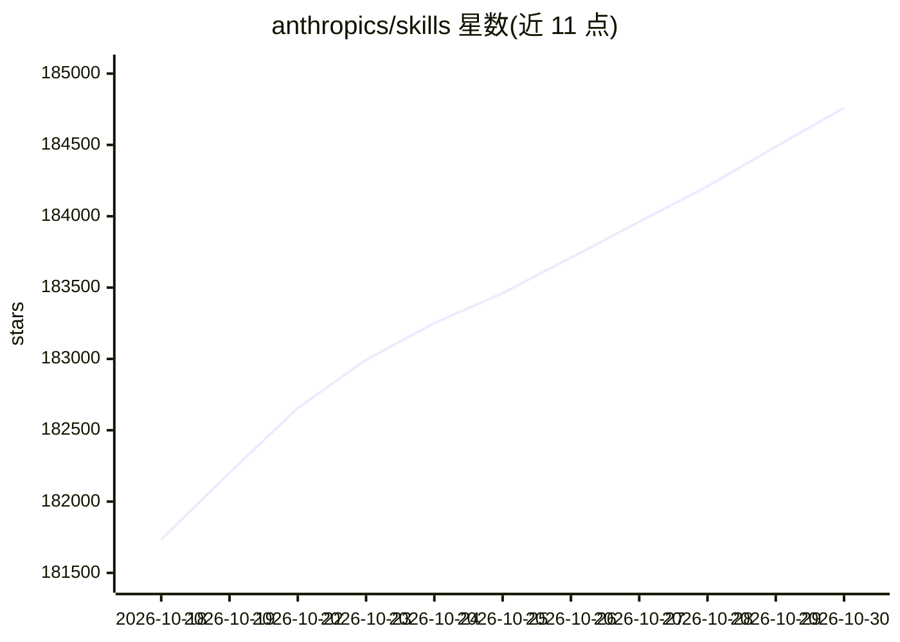

# anthropics/skills

⭐ 184,760 · Python · 推送 2026-10-28 · [GitHub](https://github.com/anthropics/skills) · 组织维护

**为 Claude 提供 Agent Skills 示例、规范与模板的官方仓库**

Anthropic 官方的 Agent Skills 仓库：Skill 是含 SKILL.md（YAML frontmatter + 指令）的文件夹，Claude 按任务动态加载。仓库包含四类示例技能（创意、技术、企业、文档）、Agent Skills 规范与模板，文档类 docx/pdf/pptx/xlsx 技能为 source-available 许可，其余多为 Apache 2.0。官方声明仅供演示与教学用途，关键任务前需自行测试。可通过 Claude Code 插件市场、Claude.ai（付费计划）及 Claude API 使用。

## 筛选速览

| 维度 | 判定 | 备注 |
|---|---|---|
| AI 角色 | `ai-ecosystem` | LLM/agent 周边工具 |
| 许可风险 | `dual` | — |
| 部署形态 | `None` |  |
| 模型依赖 | locked-api |  |
| 硬件要求 | — | 无带数字的原话,不猜 |
| 安装摩擦 | `low` | 无编译、无系统依赖或容器化 |
| 成熟度 | — | 结构信号不足 |

## 动量与使用信号

- 维护:`active` — 距上次 push 8.5 天,年发版 0,15 位贡献者
- 涨星:近 1 天 **+264**(自 20261016 起算)
- 安装:github 包 `release-assets` 月下载无数据
- 平台:— · 协议:MCP

## 能力要点

- 技能以 SKILL.md 文件夹形式自包含，仅需 name 与 description 两个字段
- 含文档技能（docx/pdf/pptx/xlsx）生产实现作为参考
- 可作为 Claude Code 插件市场注册安装
- 提供 Agent Skills 规范与技能模板

## 适用场景

- 在 Claude Code / Claude.ai 中安装官方示例技能
- 参考 SKILL.md 模式编写自定义技能
- 通过 Claude API 上传自定义技能扩展 Claude 能力

## 场景标签

`Agent 框架` · 领域:Agent 开发

## 证据(README 行号)

> L1: > **Note:** This repository contains Anthropic's implementation of skills for Claude. For information about the Agen
> L16: This repository contains skills that demonstrate what's possible with Claude's skills system. These skills range fr
> L20: Many skills in this repo are open source (Apache 2.0). We've also included the document creation & editing skills t

## 星数曲线

2026-10-18 181,734 → 2026-10-30 184,760（+3,026）

---
*卡片 v1 · prompt 1.4 · 生成 2026-10-18 · 置信度 high · 依据 README sha `3dd6bd741102` · [字段定义](../../DATASET.md)*
