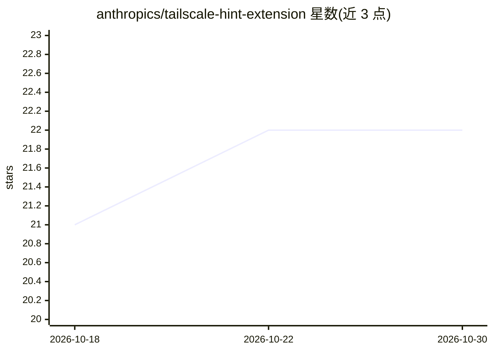

# anthropics/tailscale-hint-extension

⭐ 22 · HTML · 推送 2025-12-29 · [GitHub](https://github.com/anthropics/tailscale-hint-extension) · 组织维护

**Tailscale .local 域名解析失败时显示排障提示的 Chrome 扩展**

面向使用 Tailscale MagicDNS 的用户的浏览器扩展：当 .local 域名 DNS 解析失败时拦截错误事件，重定向到提示页面，区分『Tailscale 宕机』与『服务不可用』两种情况。页面提供目标服务与基础设施连通性的实时监控图表，连接恢复后自动跳回原地址，点击可复制延迟统计，并附内部支持渠道与 Tailscale 文档链接。通过 chrome://extensions 开发者模式加载未打包目录安装，代码含 Manifest V3 配置与后台 service worker。

## 筛选速览

| 维度 | 判定 | 备注 |
|---|---|---|
| AI 角色 | `ai-enhanced` | 去掉 AI 部分产品仍成立 |
| 许可风险 | `none` | — |
| 部署形态 | `None` |  |
| 模型依赖 | — | README 未给出锁定关系 |
| 硬件要求 | — | 无带数字的原话,不猜 |
| 安装摩擦 | `low` | 无编译、无系统依赖或容器化 |
| 成熟度 | — | 结构信号不足 |

## 能力要点

- 拦截 .local 域名的 DNS 解析失败并展示排障页面
- 区分 Tailscale 宕机与服务不可用两种故障
- 目标服务与基础设施双路实时连通性监控图表
- 连接恢复后自动重定向回原 URL

## 适用场景

- 访问 Tailscale 内网服务时快速判断是 VPN 断连还是服务故障
- 排查 .local MagicDNS 域名解析失败问题

## 场景标签

 · 领域:网络/运维工具

## 证据(README 行号)

> L3: Chrome extension that shows helpful troubleshooting when `.local` domains (Tailscale MagicDNS) fail to resolve.
> L33: - `manifest.json` - Extension manifest (Manifest V3)

## 星数曲线

2026-10-18 21 → 2026-10-30 22（+1）

---
*卡片 v1 · prompt 1.4 · 生成 2026-10-27 · 置信度 mid · 依据 README sha `25140ee9e06c` · [字段定义](../../DATASET.md)*
