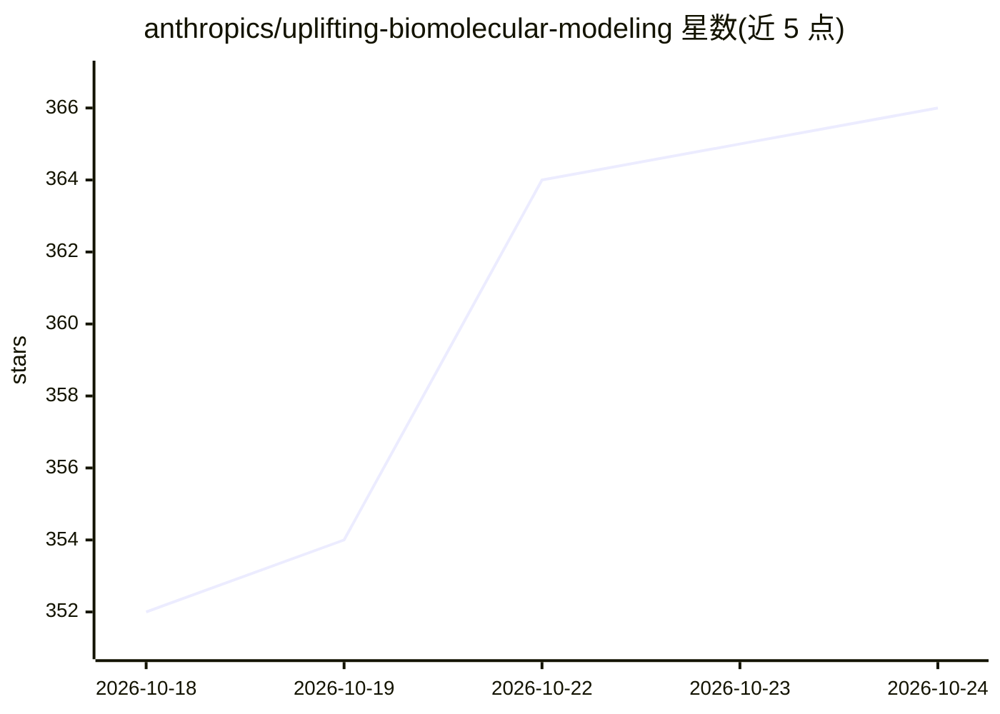

# anthropics/uplifting-biomolecular-modeling

⭐ 367 · Python · Apache-2.0 · 推送 2026-10-24 · [GitHub](https://github.com/anthropics/uplifting-biomolecular-modeling) · 组织维护

**36 个蛋白质/基因组学 ML 工具的推理加速套件（Anthropic）**

Anthropic 发布的推理优化套件集：为 36 个开源蛋白质与基因组学 ML 工具（结构预测、共折叠、binder/序列设计、蛋白与基因组语言模型）各提供一个即插即用加速包，每个 kit 携带固定版本的上游原版（stock/）并按命名模式（off/exact/fast/big）启用优化，调用上游工具的方式不变。提供 Docker、Apptainer 与 Python venv 三条安装路线，部分模式可跨多 GPU 拆分大预测。声明为不再维护的参考版本，不接受 PR，随博客文章发布。

## 筛选速览

| 维度 | 判定 | 备注 |
|---|---|---|
| AI 角色 | `ai-ecosystem` | LLM/agent 周边工具 |
| 许可风险 | `permissive` | Apache-2.0 |
| 部署形态 | `self-host` | docker 或自建部署 |
| 模型依赖 | — | README 未给出锁定关系 |
| 硬件要求 | — | 无带数字的原话,不猜 |
| 安装摩擦 | `low` | 无编译、无系统依赖或容器化 |
| 成熟度 | `idea` | |

## 能力要点

- 每 kit 一个上游工具，固定版本随附原版（stock/）
- 统一模式词汇：off/exact/fast/big，big 可跨 P 块 GPU 拆分预测
- Docker / Apptainer / Python venv 三种部署路线
- 共享运行时 opt_core：模式解析、确定性辅助、多 GPU 与共享 GPU 内核

## 适用场景

- 加速现有蛋白质结构预测或序列设计工具的推理
- 在不改变调用方式的前提下降低大输入的 GPU 显存峰值
- 在 HPC 集群上用 Apptainer 单文件镜像运行加速工具

## 场景标签

`推理引擎` · 领域:训练与推理

## 证据(README 行号)

> L3: 36 drop-in optimization kits for the inference paths of open protein- and genomics-ML tools: structure prediction an
> L6: - Each kit lives in its own directory, next to a copy of the upstream release at a pinned version ('stock'), carried
> L31: - `exact` — outputs identical to `off`, faster.

## 星数曲线

2026-10-18 352 → 2026-10-24 366（+14）

---
*卡片 v1 · prompt 1.4 · 生成 2026-10-21 · 置信度 high · 依据 README sha `0ff8aed9b066` · [字段定义](../../DATASET.md)*
