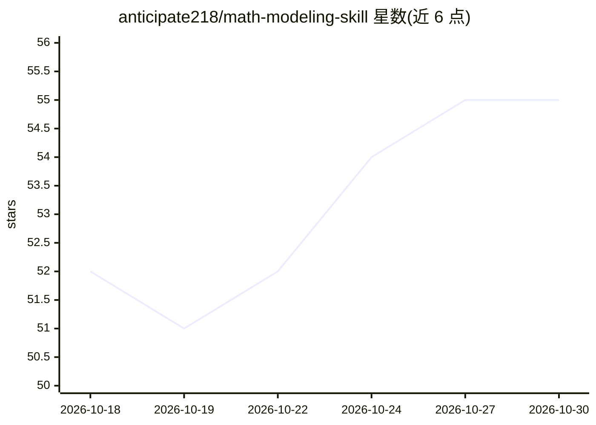

# anticipate218/math-modeling-skill

⭐ 55 · Python · MIT · 推送 2026-10-10 · [GitHub](https://github.com/anticipate218/math-modeling-skill) · 个人维护 · 中文 README

**给 AI 助手的数学建模竞赛技能包：选题建模到论文合规全流程**

面向 AI 编码/科研助手的 Agent Skill（SKILL.md 格式技能包），覆盖国赛 CUMCM、华为杯研赛、美赛 MCM/ICM 三大数学建模竞赛：提供 7 步流程主控文档、评阅四维标准、提交红线清单、提示词模板（T0–T8）与多套 LaTeX 论文模板（含华为杯 2026 严格格式版）。附带 17 个算法模块、260 个仅依赖 numpy 的函数，含固定种子与黄金值回归；另有论文自检脚本输出 FAIL/WARN 分级（含 AI 使用声明合规）。通过安装器脚本或 git clone 装入宿主技能目录，宿主按场景自动加载；不隶属任何竞赛组委会。

## 筛选速览

| 维度 | 判定 | 备注 |
|---|---|---|
| AI 角色 | `ai-knowledge` | 知识聚合/清单类 |
| 许可风险 | `permissive` | MIT |
| 部署形态 | `desktop` | 安装包/桌面程序 |
| 模型依赖 | — | README 未给出锁定关系 |
| 硬件要求 | — | 无带数字的原话,不猜 |
| 安装摩擦 | `low` | 无编译、无系统依赖或容器化 |
| 成熟度 | — | 结构信号不足 |

## 能力要点

- 全流程 7 步主控文档 + 官方评奖四维标准 + 提交红线清单
- 17 个算法模块、260 个函数，仅依赖 numpy，随机算法固定种子可复现
- 三大赛事 LaTeX 模板（完整文档类版与轻量自包含版并存）
- 论文自检脚本覆盖必备章节、匿名合规、AI 工具使用声明等

## 适用场景

- 参赛前让 AI 助手帮我审题、选模型、设计检验方案
- 按赛事规则用现成 LaTeX 模板生成可编译的论文版式
- 提交前跑自检脚本逐项核对合规红线（含 AI 使用声明）
- 直接取用 AHP/熵权/TOPSIS 等算法的可运行实现

## 场景标签

`提示工程` `科研工具` · 领域:Agent 开发

## 证据(README 行号)

> L8: 一个给 AI 编码/科研助手用的 **数学建模竞赛技能**（Agent Skill）：把一道赛题变成一篇**评委愿意给高分的论文**。
> L20: ├── SKILL.md                      # 主控：全流程 7 步 + 官方评奖四维 + 红线 + Gotchas
> L25: 设计上遵循 Agent Skills 的**渐进式披露**原则：`SKILL.md` 只放"每次都要用到"的核心流程，详细资料放进 `references/` 由助手按需读取。

## 星数曲线

2026-10-18 52 → 2026-10-30 55（+3）

---
*卡片 v1 · prompt 1.4 · 生成 2026-10-24 · 置信度 high · 依据 README sha `08f9bde90c55` · [字段定义](../../DATASET.md)*
