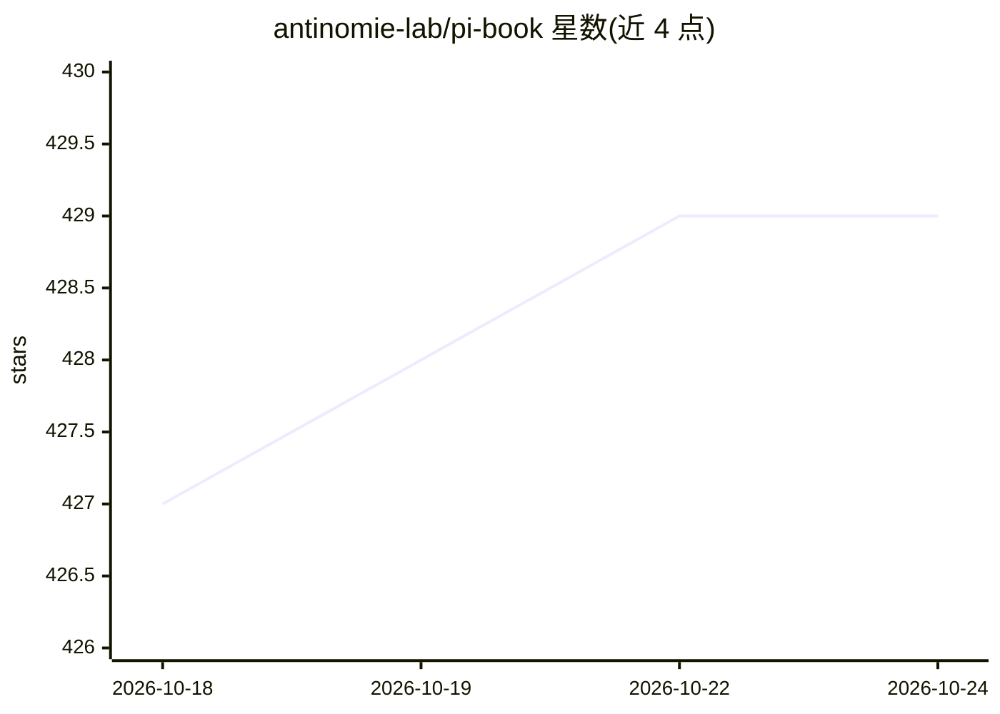

# antinomie-lab/pi-book

⭐ 429 · Vue · 推送 2026-08-24 · [GitHub](https://github.com/antinomie-lab/pi-book) · [官网](https://books.antinomie.org/pi) · 个人维护 · 中文 README

**逐行解读 pi-agent-core 源码架构的中文开源书**

以 pi 仓库 packages/agent（@earendil-works/pi-agent-core）为对象的架构书工作区：从代码出发讲解这个库式 agent 循环的承诺、拒绝与支点。代码引用以 文件:行号 格式呈现并就地附引文，读者无需打开编辑器即可核对论断。全书锁定 main 分支特定 commit，中文原稿为唯一内容源头，另附英文与西班牙文译本；仓库同时包含一个 Vite+Vue 的 Web 阅读器，可本地运行渲染原稿。读者需具备 TypeScript 与 LLM API 基础概念。

## 筛选速览

| 维度 | 判定 | 备注 |
|---|---|---|
| AI 角色 | `ai-knowledge` | 知识聚合/清单类 |
| 许可风险 | `none` | — |
| 部署形态 | `library` | 以包/库形式分发 |
| 模型依赖 | — | README 未给出锁定关系 |
| 硬件要求 | — | 无带数字的原话,不猜 |
| 安装摩擦 | `low` | 无编译、无系统依赖或容器化 |
| 成熟度 | — | 结构信号不足 |

## 能力要点

- 代码引用采用 文件:行号 格式并附原文引文，可离线核对
- 对应 pi 仓库 main 分支固定 commit cd20a8d2e
- 中文原稿唯一内容源头，提供中/英/西三语版本
- 随附 Vite+Vue Web 阅读器，支持在线与本地阅读

## 适用场景

- 学习一个 TypeScript agent 循环库的架构设计与取舍
- 配合 Claude / Cursor 等 AI 工具对照源码边读边问
- 下载 Markdown 版本离线阅读并核对书中代码论断

## 场景标签

`教程课程` · 领域:学习与行业

## 证据(README 行号)

> L7: 一本中文架构书的工作区。对象是 pi 仓库的 `packages/agent`。
> L11: 这本书从代码出发，讲清楚 `@earendil-works/pi-agent-core` 是怎么搭起来的：它承诺什么、拒绝什么、支点在哪里。全书对应 pi 仓库 main 分支的 commit `cd20a8d2e`。代码引用写成

## 星数曲线

2026-10-18 427 → 2026-10-24 429（+2）

---
*卡片 v1 · prompt 1.4 · 生成 2026-10-21 · 置信度 high · 依据 README sha `43e8e2e7979e` · [字段定义](../../DATASET.md)*
