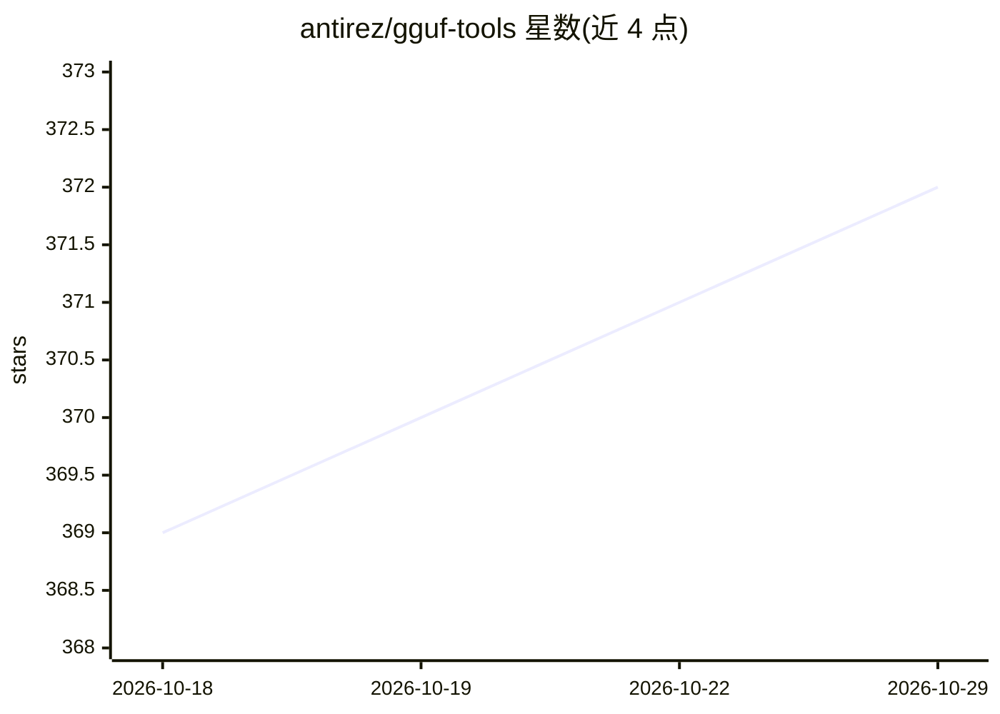

# antirez/gguf-tools

⭐ 372 · C · MIT · 推送 2026-05-16 · [GitHub](https://github.com/antirez/gguf-tools) · 个人维护

**C 语言 GGUF 文件操作库与 CLI 工具：解析/比较/检查模型文件**

antirez 用 C 编写的 GGUF 文件操作库（gguflib）及配套 CLI（gguf-tools），目标之一是以可读代码库侧面记录 GGUF 文件格式。CLI 提供 show（展示键值对与张量信息）、compare（按张量平均权重差异判断两个模型是否同源/微调关系）、inspect-tensor（查看张量权重值用于量化检查与模型指纹）、split-mixtral（从 Mixtral MoE 提取实验性 7B 模型，作者声明该子命令可能移除）。面向本地机器学习场景的开发者；API 仅以源码为文档，处于活跃开发中，许多量化格式尚未支持。

## 筛选速览

| 维度 | 判定 | 备注 |
|---|---|---|
| AI 角色 | `ai-ecosystem` | LLM/agent 周边工具 |
| 许可风险 | `permissive` | MIT |
| 部署形态 | `None` |  |
| 模型依赖 | — | README 未给出锁定关系 |
| 硬件要求 | — | 无带数字的原话,不猜 |
| 安装摩擦 | `low` | 无编译、无系统依赖或容器化 |
| 成熟度 | `idea` | |

## 能力要点

- show 子命令输出 GGUF 文件全部键值对与张量详细信息
- compare 按张量计算平均权重差异，判断模型微调关系与冻结层
- inspect-tensor 支持查看张量权重值，用于量化误差检查与模型指纹
- split-mixtral 可从 Mixtral MoE 按 MoE ID 提取 7B 模型（实验性）

## 适用场景

- 查看本地 GGUF 模型文件的元数据与张量结构
- 判断两个 GGUF 模型是否同一父模型的微调
- 低层检查量化权重值与引入的误差

## 场景标签

 · 领域:机器学习基础设施/模型文件格式

## 证据(README 行号)

> L3: This is a work in progress library to manipulate GGUF files.
> L6: files used by the awesome llama.cpp project: GGUF files are becoming increasingly more used and central in
> L10: The program **gguf-tools** uses the library to implement both useful and

## 星数曲线

2026-10-18 369 → 2026-10-29 372（+3）

---
*卡片 v1 · prompt 1.4 · 生成 2026-10-21 · 置信度 high · 依据 README sha `4e4b583c7d5b` · [字段定义](../../DATASET.md)*
