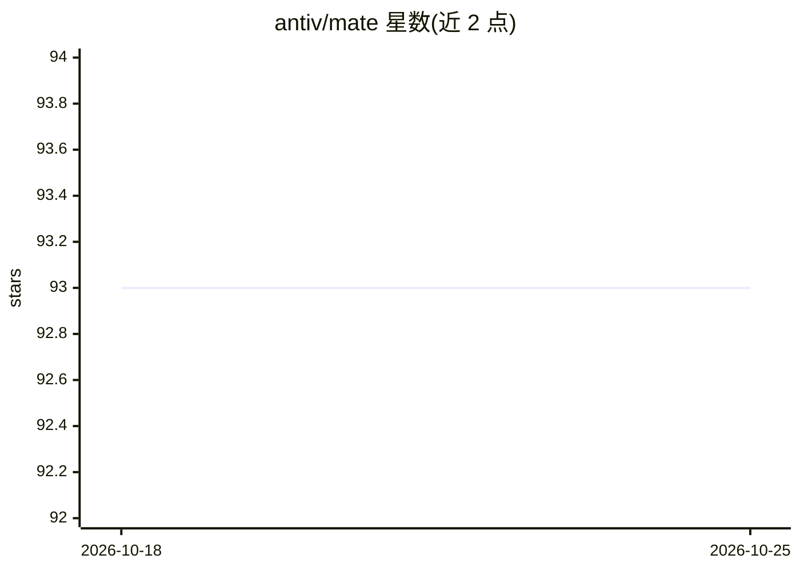

# antiv/mate

⭐ 93 · Python · Apache-2.0 · 推送 2026-10-25 · [GitHub](https://github.com/antiv/mate) · [官网](https://antonijevic.rs/mate) · 个人维护

**自托管多 agent 编排与治理平台：仪表盘改配置无需重部署**

基于 Google ADK 或 LangGraph 构建的自托管多 agent 编排引擎，agent 配置存于数据库并版本化，通过拖拽画布构建 agent 层级、挂载工具与 MCP 服务器，改动即时生效可回滚。治理侧提供按 agent 的 RBAC、按美元/Token 计费的预算告警与封禁、护栏、审计日志；测试侧含自动评测套件（精确匹配/相似度/LLM-as-Judge）与模型、提示词对比的 Playground。经 LiteLLM 支持 50+ 模型供应商，含 Ollama、LM Studio、llama.cpp 等本地运行时，提供 OpenAI 兼容 API、A2A 与嵌入式聊天组件。

## 筛选速览

| 维度 | 判定 | 备注 |
|---|---|---|
| AI 角色 | `ai-ecosystem` | LLM/agent 周边工具 |
| 许可风险 | `permissive` | Apache-2.0 |
| 部署形态 | `self-host` | docker 或自建部署 |
| 模型依赖 | local-ok | 支持本地模型 |
| 硬件要求 | — | 无带数字的原话,不猜 |
| 安装摩擦 | `low` | 无编译、无系统依赖或容器化 |
| 成熟度 | — | 结构信号不足 |

## 能力要点

- 数据库驱动的 agent 配置，画布编辑即时生效、一键回滚
- 按 agent 的 RBAC、美元/Token 预算与告警（Slack/Discord/email/webhook）
- 自动评测套件（LLM-as-Judge）与回归阈值 webhook
- 经 LiteLLM 接入 50+ 供应商，含 Ollama/LM Studio/llama.cpp 本地后端

## 适用场景

- 在仪表盘中调提示词、换模型而不改代码重新部署
- 对生产环境多 agent 按用户/团队做访问控制与成本管控
- 上线前用评测套件与 Playground 对比模型与提示词效果

## 场景标签

`Agent 框架` `多智能体` `模型网关` `模型评测` · 领域:Agent 开发

## 证据(README 行号)

> L4: Self-hosted, on Google ADK or LangGraph, with any of 50+ LLM providers.
> L56: Without a control layer, every one of those is a code change, a commit, and a redeploy. **MATE is that control laye
> L186: ## Why MATE vs. raw ADK

## 星数曲线

2026-10-18 93 → 2026-10-25 93（+0）

---
*卡片 v1 · prompt 1.4 · 生成 2026-10-23 · 置信度 mid · 依据 README sha `9fe04740ec87` · [字段定义](../../DATASET.md)*
