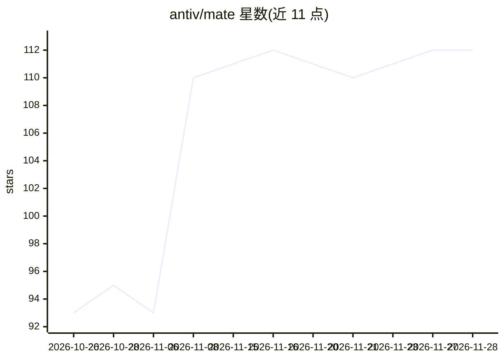

# antiv/mate

⭐ 112 · Python · Apache-2.0 · 推送 2026-11-25 · [GitHub](https://github.com/antiv/mate) · [官网](https://antonijevic.rs/mate) · 个人维护

**给生产环境 agent 团队的可视化编排与治理控制台**

基于 Google ADK（亦可跑 LangGraph）构建的多 agent 编排引擎，以 Web 控制台为中心：可视化画布编辑 agent 层级与工具，配置存数据库、改动即时生效无需重新部署。治理侧提供每 agent 的 RBAC、按美元计价的成本核算、预算告警/阻断、Slack/Discord/邮件告警与审计日志；评测侧提供精确匹配/相似度/LLM-judge 的回归测试套件与对比 Playground。支持 MCP、A2A、OpenAI 兼容 API 与嵌入式聊天组件。默认 SQLite 存储，Docker 一条命令即可启动，个人维护者发布。

## 筛选速览

| 维度 | 判定 | 备注 |
|---|---|---|
| AI 角色 | `ai-ecosystem` | LLM/agent 周边工具 |
| 许可风险 | `permissive` | Apache-2.0 |
| 部署形态 | `self-host` | docker 或自建部署 |
| 模型依赖 | local-ok | 支持本地模型 |
| 硬件要求 | — | 无带数字的原话,不猜 |
| 安装摩擦 | `low` | 无编译、无系统依赖或容器化 |
| 成熟度 | — | 结构信号不足 |

## 能力要点

- 拖拽画布构建 agent 层级，配置入库、版本化、一键回滚
- 每 agent 美元成本核算、预算阻断与 RBAC 访问控制
- Trace Replay 在画布上回放多 agent 会话执行过程
- 评测框架支持精确匹配/语义相似度/LLM-as-Judge 计分

## 适用场景

- 不重启服务就能调整线上 agent 的提示词与模型
- 为多团队 agent 平台加权限、预算与审计
- 上线前用回归测试套件防止提示词改动破坏旧逻辑

## 场景标签

`多智能体` `模型评测` · 领域:Agent 开发

## 证据(README 行号)

> L1: # MATE — The Command Center for AI Agents
> L4: Self-hosted, on Google ADK or LangGraph, with any of 50+ LLM providers.
> L56: Without a control layer, every one of those is a code change, a commit, and a redeploy. **MATE is that control laye

## 星数曲线

2026-10-26 93 → 2026-11-28 112（+19）

---
*卡片 v1 · prompt 1.4 · 生成 2026-11-28 · 置信度 high · 依据 README sha `3fcbde409a36` · [字段定义](../../DATASET.md)*
