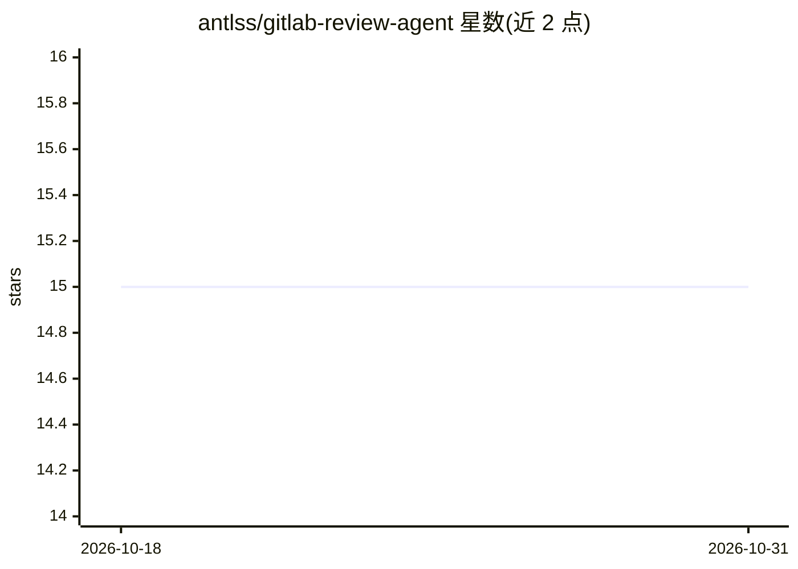

# antlss/gitlab-review-agent

⭐ 15 · Go · MIT · 推送 2026-04-02 · [GitHub](https://github.com/antlss/gitlab-review-agent) · 个人维护

**GitLab Merge Request 的 AI 代码审查 agent，多 LLM 路由**

用 Go 编写、面向 GitLab MR 的自动化代码审查助手：通过 webhook 监听带触发标签的 MR，克隆仓库、用工具（read_file/search_code）在代码库中导航验证后再生成行内评论；支持多轮回复辩论、自动解决已修复的旧评论线程，后台 Cron 任务将历史审查与人工反馈沉淀为仓库最佳实践规则。原生支持 OpenAI、Anthropic、Google 三家 LLM 并提供负载均衡与回退。部署方式为 Docker Compose 或 Go 源码编译，另有本地 CLI 干跑模式供交互式选择性发布评论。

## 筛选速览

| 维度 | 判定 | 备注 |
|---|---|---|
| AI 角色 | `ai-native` | 本体是模型或模型工具 |
| 许可风险 | `permissive` | MIT |
| 部署形态 | `self-host` | docker 或自建部署 |
| 模型依赖 | locked-api |  |
| 硬件要求 | — | 无带数字的原话,不猜 |
| 安装摩擦 | `low` | 无编译、无系统依赖或容器化 |
| 成熟度 | — | 结构信号不足 |

## 能力要点

- agentic 循环中用 read_file/search_code 工具核对真实代码后再评论
- 原生支持 OpenAI/Anthropic/Google 三家 LLM，带负载均衡与回退
- 后台 Cron 将历史审查与人工反馈整合为仓库最佳实践规则书
- 本地 CLI 干跑模式：终端展示结果并交互式选择要推送的评论

## 适用场景

- 在 GitLab MR 上自动触发带上下文的 AI 代码审查
- 团队按仓库沉淀的规范让 AI 持续执行既定最佳实践
- 在终端本地干跑审查，挑选评论再发布到 GitLab

## 场景标签

`代码审查` · 领域:编码与开发

## 证据(README 行号)

> L8: > **More than just a `.patch` reader.** AI Review Agent is an autonomous, context-aware code review assistant design
> L16: - 🔀 **Robust Multi-LLM Routing:** Avoid vendor lock-in. Natively supports **OpenAI (GPT-4o)**, **Anthropic (Claude 

## 星数曲线

2026-10-18 15 → 2026-10-31 15（+0）

---
*卡片 v1 · prompt 1.4 · 生成 2026-10-30 · 置信度 high · 依据 README sha `f3b79ff61f4b` · [字段定义](../../DATASET.md)*
