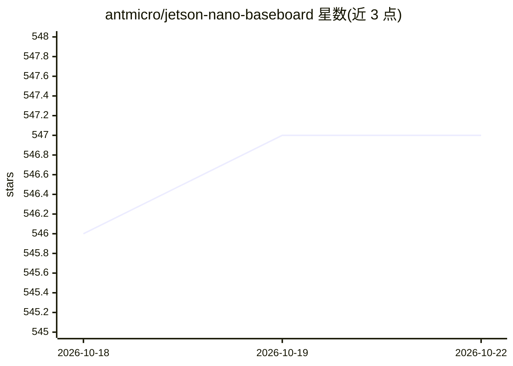

# antmicro/jetson-nano-baseboard

⭐ 548 · Apache-2.0 · 推送 2025-12-31 · [GitHub](https://github.com/antmicro/jetson-nano-baseboard) · [官网](https://antmicro.com/platforms/open-jetson-nano-xavier-nx-baseboard/) · 组织维护

**NVIDIA Jetson Nano/Xavier NX/TX2 NX 模组的开源底板硬件设计**

Antmicro 提供的开源硬件底板设计文件项目，支持 NVIDIA Jetson Nano、Xavier NX 与 TX2 NX 三款 SoM，提供 SO-DIMM 连接器、千兆网口、USB-C/HDMI/Mini DisplayPort、2x50-pin FFC 连接器（最多 4 路 MIPI CSI-2 相机）、M.2 PCIe x4、RTC 备份与 EEPROM。Rev 1.5 起设计文件以 KiCad 维护，旧版本在 Altium Designer 分支。底板 I/O 由 NVIDIA 标准 L4T BSP 支持，附带给 Allied Vision 相机的 Linux 补丁；供硬件制造与自行生产组装的用户使用，Apache-2.0 许可。

## 筛选速览

| 维度 | 判定 | 备注 |
|---|---|---|
| AI 角色 | `ai-ecosystem` | LLM/agent 周边工具 |
| 许可风险 | `permissive` | Apache-2.0 |
| 部署形态 | `None` |  |
| 模型依赖 | — | README 未给出锁定关系 |
| 硬件要求 | — | 无带数字的原话,不猜 |
| 安装摩擦 | `low` | 无编译、无系统依赖或容器化 |
| 成熟度 | — | 结构信号不足 |

## 能力要点

- 支持 Jetson Nano / Xavier NX / TX2 NX 三款 SoM 的 SO-DIMM 底板
- 最多 4 路 MIPI CSI-2 相机接口（FFC 连接器）
- KiCad 开源设计文件，可直接生产组装（100x55mm 外形）
- 附带 Allied Vision 相机的 Linux 内核补丁目录

## 适用场景

- 为 Jetson SoM 制造配套的载板用于嵌入式视觉系统
- 搭建多相机 MIPI CSI-2 采集的边缘 AI 硬件平台
- 参考开源底板设计定制自己的 Jetson 载板

## 场景标签

 · 领域:开源硬件/嵌入式计算

## 证据(README 行号)

> L11: This project contains open hardware design files for a baseboard supporting the NVIDIA Jetson Nano, Xavier NX and T
> L12: It was created by Antmicro, a custom hardware, software and AI engineering company and NVIDIA's Jetson ecosystem pa

## 星数曲线

2026-10-18 546 → 2026-10-22 547（+1）

---
*卡片 v1 · prompt 1.4 · 生成 2026-10-21 · 置信度 mid · 依据 README sha `129a572dbe9a` · [字段定义](../../DATASET.md)*
