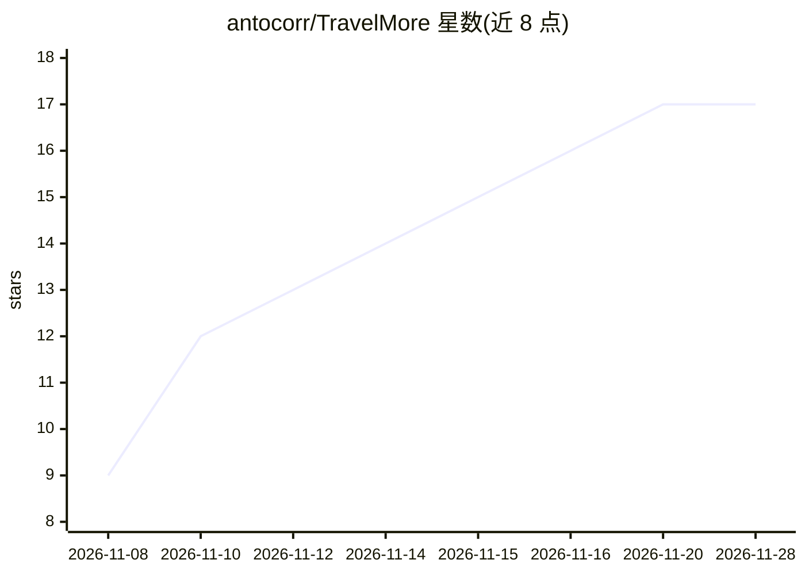

# antocorr/TravelMore

⭐ 17 · TypeScript · MIT · 推送 2026-11-16 · [GitHub](https://github.com/antocorr/TravelMore) · 个人维护

**本地自托管的 AI 旅行规划器：行程树、地图与机票价格监控**

自托管的全栈旅行规划应用：以行程树（trip→stops→places）组织行程，集成 OpenStreetMap/Leaflet 地图与搜索、Nominatim/Wikipedia 地点补全、清单与照片管理。核心的 AI 助手基于 Pi SDK，通过服务端工具直接创建与编辑行程记录，支持 OpenAI/Anthropic/Google/Codex 协议接入自选模型，可经 ChatGPT OAuth 登录。另含实验性的机票价格监控（Google Flights/Skyscanner 适配、Chrome 专用配置文件）。数据存于本地 JSON 存储，无内置身份认证，跨设备访问仅限可信网络。从 npm workspace 源码运行，需 Node.js 22.19+。

## 筛选速览

| 维度 | 判定 | 备注 |
|---|---|---|
| AI 角色 | `ai-native` | 本体是模型或模型工具 |
| 许可风险 | `permissive` | MIT |
| 部署形态 | `library` | 以包/库形式分发 |
| 模型依赖 | — | README 未给出锁定关系 |
| 硬件要求 | — | 无带数字的原话,不猜 |
| 安装摩擦 | `low` | 无编译、无系统依赖或容器化 |
| 成熟度 | `idea` | |

## 能力要点

- 工具驱动的 AI 助手直接读写行程记录（含来源溯源与破坏性工具禁用）
- 多协议接入自选模型（OpenAI/Anthropic/Google/Codex）及 ChatGPT OAuth 登录
- OpenStreetMap 地图 + Nominatim/Wikipedia 地点补全
- 实验性机票价格监控：Google Flights/Skyscanner 扫描、价格历史、CLI

## 适用场景

- 把对话式需求转成可编辑的行程、地图点位与清单
- 自托管管理我的行程库，数据留在自己的服务器
- 跟踪多条航线多个日期的机票价格变化

## 场景标签

`AI 助手` `网页抓取` · 领域:效率与自动化

## 证据(README 行号)

> L5: Itineraries, maps, places, checklists and flights in one local workspace—with an AI assistant that works on your pla
> L34: |**Work with AI**|Tool-based itinerary creation and editing, sourced web research, place enrichment, checklists and
> L138: Providers are interchangeable through OpenAI Completions/Responses, Anthropic Messages, Google

## 星数曲线

2026-11-08 9 → 2026-11-28 17（+8）

---
*卡片 v1 · prompt 1.4 · 生成 2026-11-18 · 置信度 high · 依据 README sha `501c739054cd` · [字段定义](../../DATASET.md)*
