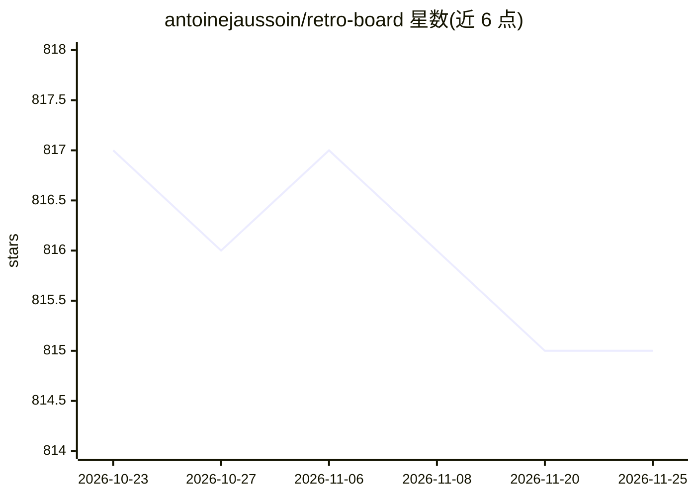

# antoinejaussoin/retro-board

⭐ 815 · TypeScript · GPL-3.0 · 推送 2026-11-21 · [GitHub](https://github.com/antoinejaussoin/retro-board) · [官网](https://www.retrospected.com) · 个人维护

**为工程团队提供带 AI 教练的敏捷回顾看板**

Retrospected 是一个实时敏捷回顾看板，团队可在板上添加卡片、分组、投票并生成回顾总结。技术栈为 React 19 前端加 Rust（Axum/Tokio/sqlx）后端，数据存储用 Postgres 16，实时协作基于 Socket.IO，支持多语言（i18next）与多种 OAuth 登录。AI 部分包括由 Claude 驱动的敏捷教练和回顾总结撰写。提供公共托管版和自托管两种使用方式；自托管为演示版，需购买 Self Hosted 许可转为完整版本。

## 筛选速览

| 维度 | 判定 | 备注 |
|---|---|---|
| AI 角色 | `ai-enhanced` | 去掉 AI 部分产品仍成立 |
| 许可风险 | `viral` | GPL-3.0 |
| 部署形态 | `self-host` | docker 或自建部署 |
| 模型依赖 | locked-api |  |
| 硬件要求 | — | 无带数字的原话,不猜 |
| 安装摩擦 | `low` | 无编译、无系统依赖或容器化 |
| 成熟度 | — | 结构信号不足 |

## 能力要点

- 实时协作看板：卡片、分组、投票、计时器、主持人角色
- Claude 驱动的 AI 教练与回顾总结撰写
- Docker 部署与多架构镜像（含 ARM 服务器）
- 自托管支持白标定制、管理面板与 AES-GCM 卡片加密

## 适用场景

- Sprint 结束后团队在线做敏捷回顾
- 自托管部署供公司内部团队使用
- 让 AI 教练辅助并自动撰写回顾总结

## 场景标签

`AI 写作` · 领域:内容生成

## 证据(README 行号)

> L8: Retrospected is a free AI-powered Real-time Agile Retrospective Board for engineering teams.
> L59: - Claude, powering the AI agile coach and the retrospective summary
> L91: ## Want to host Retrospected on your premises? 🖥

## 星数曲线

2026-10-23 817 → 2026-11-25 815（-2）

---
*卡片 v1 · prompt 1.4 · 生成 2026-11-24 · 置信度 mid · 依据 README sha `0433f702ff7d` · [字段定义](../../DATASET.md)*
