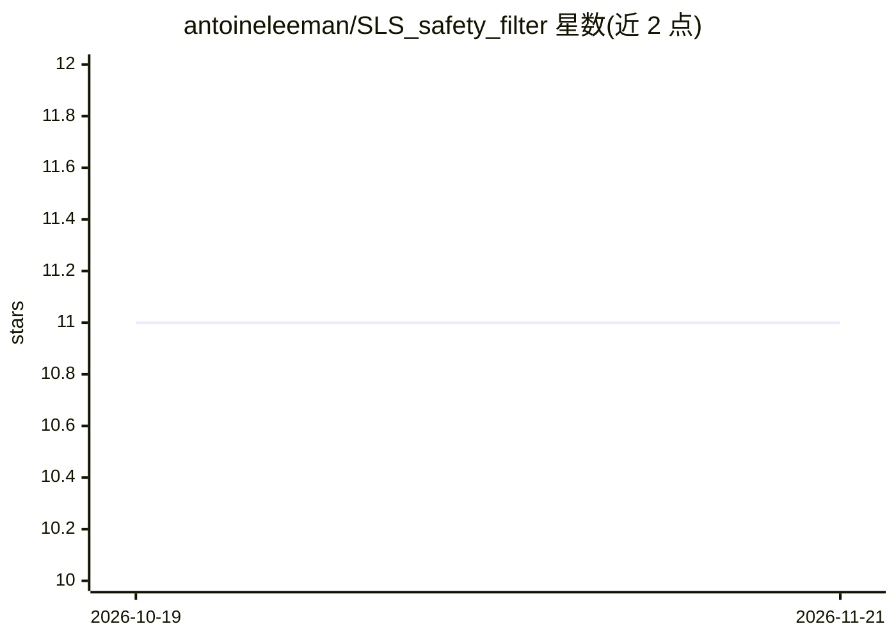

# antoineleeman/SLS_safety_filter

⭐ 11 · MATLAB · MIT · 推送 2025-12-11 · [GitHub](https://github.com/antoineleeman/SLS_safety_filter) · [官网](https://www.research-collection.ethz.ch/handle/20.500.11850/615512) · 组织维护

**控制系统安全滤波器论文的 MATLAB 复现代码**

L4DC 2023 论文《Predictive Safety Filter using System Level Synthesis》的配套 MATLAB 实现，提供基于系统级综合（SLS）的模型预测安全滤波器（SL-MPSF）方案，对受有界扰动影响的线性系统验证约束满足，另含降低在线计算量的显式变体，并附带与常规 MPSF 对比的数值示例。面向控制系统研究者，运行需 MATLAB、MPT3 与 MOSEK 求解器，无安装包，需克隆代码后加入 MATLAB 路径。

## 筛选速览

| 维度 | 判定 | 备注 |
|---|---|---|
| AI 角色 | `ai-native` | 本体是模型或模型工具 |
| 许可风险 | `permissive` | MIT |
| 部署形态 | `None` |  |
| 模型依赖 | — | README 未给出锁定关系 |
| 硬件要求 | — | 无带数字的原话,不猜 |
| 安装摩擦 | `low` | 无编译、无系统依赖或容器化 |
| 成熟度 | — | 结构信号不足 |

## 能力要点

- SL-MPSF 安全滤波器的 MATLAB 实现，保证有界扰动下线性系统的约束满足
- 含降低在线计算量的显式（explicit）变体实现
- 附带与 state-of-the-art MPSF 对比的数值示例

## 适用场景

- 复现论文中 SL-MPSF 算法与数值实验
- 为学习型控制器或人工输入的控制系统接入安全滤波
- 在 MATLAB 环境中研究显式 MPSF 变体的在线计算开销

## 场景标签

`科研工具` · 领域:学习与行业

## 证据(README 行号)

> L2: This repository contains the MATLAB code that accompanies the research paper:
> L6: This repository contains the MATLAB implementation of the System Level Synthesis based Model Predictive Safety Filte
> L19: - MATLAB (tested with version R2020b)

## 星数曲线

2026-10-19 11 → 2026-11-21 11（+0）

---
*卡片 v1 · prompt 1.4 · 生成 2026-11-18 · 置信度 mid · 依据 README sha `3020522a042b` · [字段定义](../../DATASET.md)*
