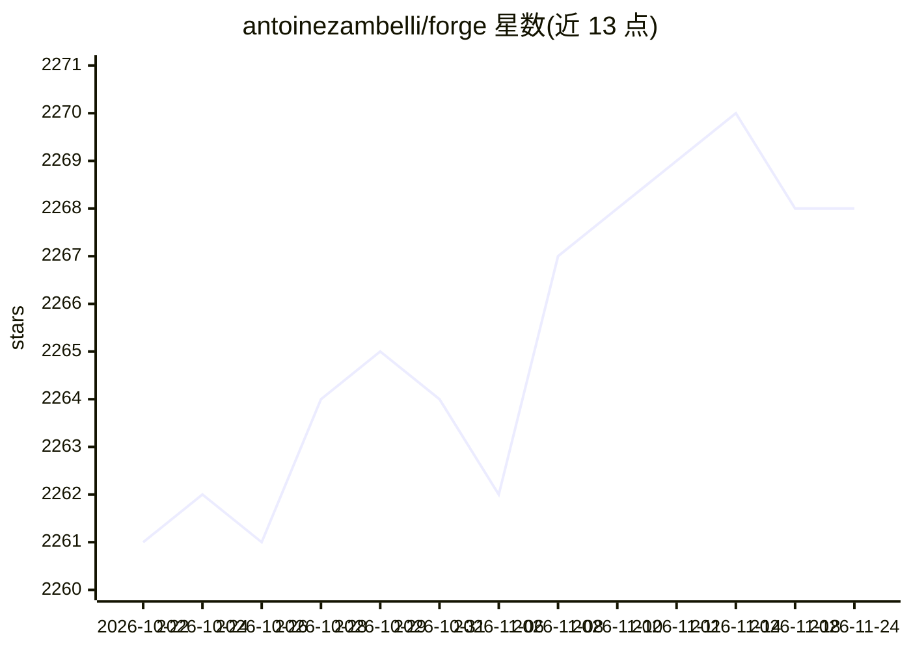

# antoinezambelli/forge

⭐ 2,268 · Python · MIT · 推送 2026-11-20 · [GitHub](https://github.com/antoinezambelli/forge) · 个人维护

**自托管 LLM 工具调用的可靠性层与代理服务**

面向自托管模型的工具调用可靠性框架：以代理服务器、WorkflowRunner 循环运行器、可组合中间件三种方式使用，提供响应校验、畸形工具调用抢救解析（支持 Mistral/Qwen 格式）、带纠错提示的重试循环等护栏。代理兼容 OpenAI chat-completions 与 Anthropic Messages 两种 API，可接入现有客户端；另提供 SlotWorker 共享推理槽队列。自述非多 agent 编排器、非编码 harness，代理模式不做会话压缩与调用方鉴权。

## 筛选速览

| 维度 | 判定 | 备注 |
|---|---|---|
| AI 角色 | `ai-ecosystem` | LLM/agent 周边工具 |
| 许可风险 | `permissive` | MIT |
| 部署形态 | `self-host` | docker 或自建部署 |
| 模型依赖 | local-ok | 支持本地模型 |
| 硬件要求 | — | 无带数字的原话,不猜 |
| 安装摩擦 | `low` | 无编译、无系统依赖或容器化 |
| 成熟度 | — | 结构信号不足 |

## 能力要点

- 独立代理进程（forge-proxy）无需宿主 Python，兼容 OpenAI/Anthropic 两种 API
- 畸形工具调用抢救解析（JSON code fence、Mistral [TOOL_CALLS]、Qwen XML）
- 支持 llama.cpp/llama-server、Ollama、Llamafile、vLLM、Anthropic 多后端
- SlotWorker 提供优先级队列与自动抢占的共享推理槽

## 适用场景

- 为本地 8B 模型的工具调用增加校验与重试护栏
- 不改代码地给 opencode/aider/Continue 等现有编码代理套上护栏
- 构建多步结构化 agent 工作流并管理上下文压缩
- 多 agent 场景下多个工作流共享一个 GPU 推理槽

## 场景标签

`Agent 框架` · 领域:Agent 开发

## 证据(README 行号)

> L9: A reliability layer for self-hosted LLM tool-calling. You give forge a set of tools; the model calls whichever it wa
> L19: - **Proxy server** — Drop-in proxy (`forge-proxy` from the standalone distribution, or `python -m forge.proxy` from
> L25: Supports generic OpenAI-compatible endpoints, Ollama, llama-server (llama.cpp),

## 星数曲线

2026-10-22 2,261 → 2026-11-24 2,268（+7）

---
*卡片 v1 · prompt 1.4 · 生成 2026-11-23 · 置信度 mid · 依据 README sha `066d451d4eee` · [字段定义](../../DATASET.md)*
