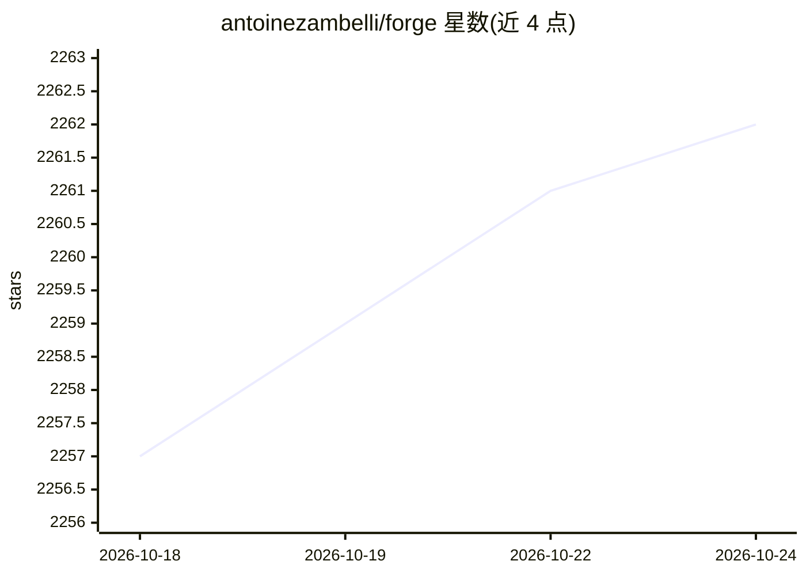

# antoinezambelli/forge

⭐ 2,262 · Python · MIT · 推送 2026-10-15 · [GitHub](https://github.com/antoinezambelli/forge) · 个人维护

**自托管 LLM 工具调用的可靠性层框架与代理**

Python 框架，面向自托管 LLM 的工具调用与多步 agentic 工作流提供可靠性保障：响应校验、畸形工具调用解析（如 Mistral/Qwen 格式）、带纠错提示的重试循环、必选步骤/前置条件约束与上下文压缩。提供三种用法：兼容 OpenAI/Anthropic API 的 drop-in 代理服务器、管理完整生命周期的 WorkflowRunner（含共享推理槽 SlotWorker）、可组合的 guardrails 中间件。支持 llama-server、Ollama、Llamafile、vLLM 等后端。限制：非多 agent 编排器；代理模式单次请求、不压缩调用方历史、不认证调用者。

## 筛选速览

| 维度 | 判定 | 备注 |
|---|---|---|
| AI 角色 | `ai-ecosystem` | LLM/agent 周边工具 |
| 许可风险 | `permissive` | MIT |
| 部署形态 | `self-host` | docker 或自建部署 |
| 模型依赖 | local-ok | 支持本地模型 |
| 硬件要求 | — | 无带数字的原话,不猜 |
| 安装摩擦 | `low` | 无编译、无系统依赖或容器化 |
| 成熟度 | — | 结构信号不足 |

## 能力要点

- 代理模式同时兼容 OpenAI chat-completions 与 Anthropic Messages API，无需改写现有客户端
- 对畸形工具调用做救援解析（Mistral [TOOL_CALLS]、Qwen XML 等）并规范化重发
- WorkflowRunner 提供必选步骤/前置条件/终止工具等工作流约束与上下文压缩
- Managed 模式可拉起 llama-server、Llamafile、vLLM 或挂接 Ollama 守护进程

## 适用场景

- 给本地小模型的工具调用加校验与重试，提升现有编码代理可靠性
- 在不改代码的前提下让 OpenAI/Anthropic 兼容客户端获得 guardrails
- 构建带步骤约束的多步 agent 工作流并共享单 GPU 推理槽

## 场景标签

`Agent 框架` `工作流自动化` · 领域:Agent 开发

## 证据(README 行号)

> L9: A reliability layer for self-hosted LLM tool-calling. You give forge a set of tools; the model calls whichever it wa
> L19: - **Proxy server** — Drop-in proxy (`forge-proxy` from the standalone distribution, or `python -m forge.proxy` from
> L23: - **Guardrails middleware** — Use forge's reliability stack (composable middleware) inside your own orchestration l

## 星数曲线

2026-10-18 2,257 → 2026-10-24 2,262（+5）

---
*卡片 v1 · prompt 1.4 · 生成 2026-10-21 · 置信度 mid · 依据 README sha `aa48f588fa5b` · [字段定义](../../DATASET.md)*
