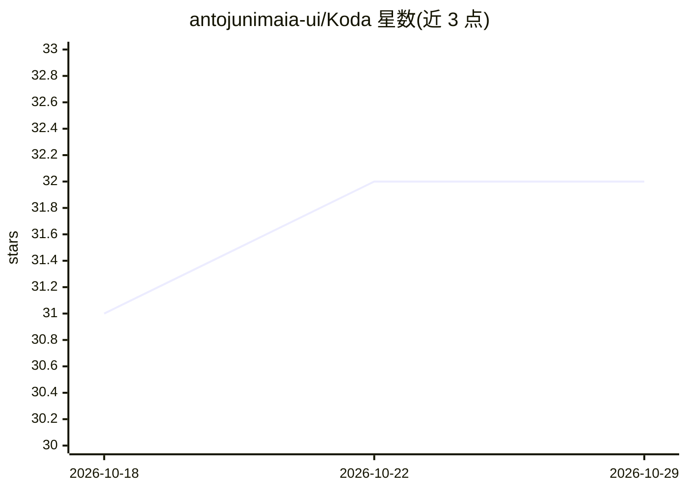

# antojunimaia-ui/Koda

⭐ 32 · TypeScript · BSD-3-Clause · 推送 2026-10-27 · [GitHub](https://github.com/antojunimaia-ui/Koda) · 个人维护

**本地运行的 AI 辅助编程 Agent 开发环境（ADE）**

Koda 是开源的 Electron 桌面应用，定位为 Agent Development Environment：AI agent 在本地读取代码库、编辑文件、通过 node-pty 运行命令并交付代码，无需 IDE 扩展或云端服务器。功能包括多工作区隔离会话、快照回滚、Git 面板、内置 PTY 终端与浏览器预览、.kodaignore 访问控制、MCP 与 LSP 集成、Markdown 技能系统及 17 个 LLM 提供商接入。运行前置条件为 Node.js 20+、Git 与任一提供商的 API key（或 Koda Cloud）。

## 筛选速览

| 维度 | 判定 | 备注 |
|---|---|---|
| AI 角色 | `ai-ecosystem` | LLM/agent 周边工具 |
| 许可风险 | `permissive` | BSD-3-Clause |
| 部署形态 | `desktop` | 安装包/桌面程序 |
| 模型依赖 | local-ok | 支持本地模型 |
| 硬件要求 | — | 无带数字的原话,不猜 |
| 安装摩擦 | `low` | 无编译、无系统依赖或容器化 |
| 成熟度 | — | 结构信号不足 |

## 能力要点

- AI agent 直接读写本地代码库并自主运行 shell 命令
- 多工作区隔离：每个会话独立的对话、PTY、MCP 连接
- 每条消息前的文件快照与一键回滚
- 17 个 LLM 提供商（含 Ollama / Llama.cpp 本地推理）动态切换

## 适用场景

- 让 AI agent 在本地项目里自主完成编码与运行任务
- 在多个项目间并行运行互相隔离的 agent 会话
- 通过 .kodaignore 限制 agent 对敏感文件的访问
- 接入本地模型做无云端依赖的辅助编程

## 场景标签

`编码 Agent` · 领域:编码与开发

## 证据(README 行号)

> L10: Koda is an Open-Source Agent Development Environment (ADE) for AI-assisted software engineering. No IDE extensions,
> L43: - **17 LLM providers** — dynamic model listing via API. Switch providers and models from the UI without restarting.

## 星数曲线

2026-10-18 31 → 2026-10-29 32（+1）

---
*卡片 v1 · prompt 1.4 · 生成 2026-10-26 · 置信度 high · 依据 README sha `e0ed6347334f` · [字段定义](../../DATASET.md)*
