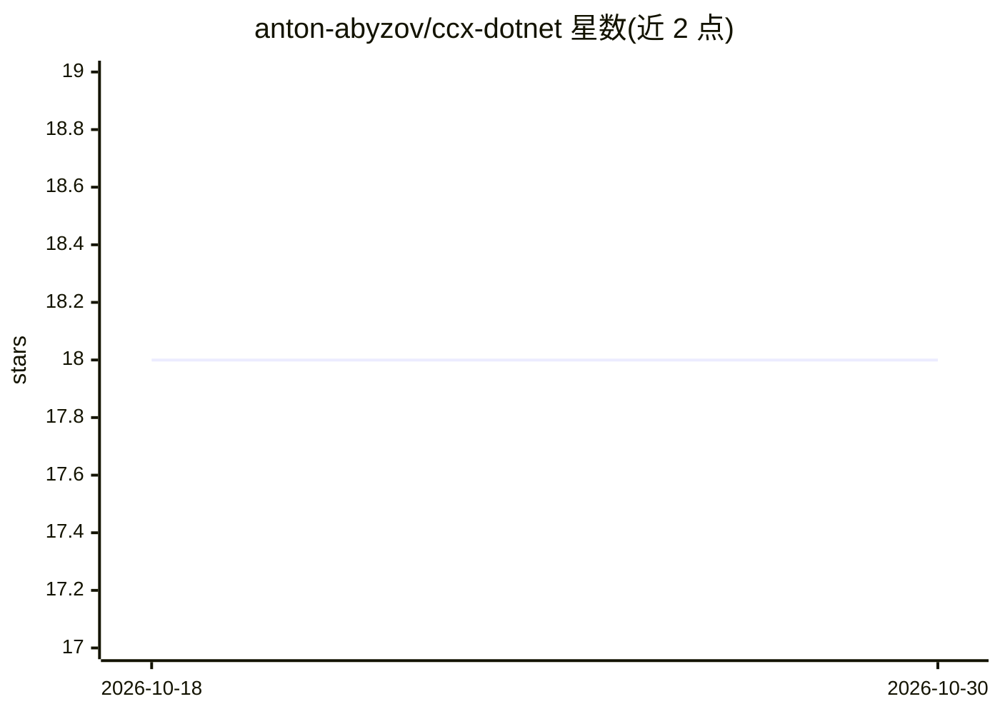

# anton-abyzov/ccx-dotnet

⭐ 18 · C# · MIT · 推送 2026-04-18 · [GitHub](https://github.com/anton-abyzov/ccx-dotnet) · 个人维护

**.NET 10 实现的 AI 编程助手 CLI，面向企业 .NET 环境**

CCX 项目的 .NET 10 实现：终端内 AI 编程助手 CLI，含 11 个内置工具（Bash、文件读写编辑、Grep、Agent、WebFetch 等）、流式 SSE 响应、Markdown 渲染、4 层上下文压缩、MCP 协议（JSON-RPC over stdio/SSE）、规则化权限审批与记忆持久化。通过 ANTHROPIC_API_KEY 接入 Claude 模型，可发布为 7.9MB AOT 单文件二进制。面向企业 .NET 开发团队，需 .NET 10 SDK，支持 dotnet tool 全局安装或源码构建。

## 筛选速览

| 维度 | 判定 | 备注 |
|---|---|---|
| AI 角色 | `ai-native` | 本体是模型或模型工具 |
| 许可风险 | `permissive` | MIT |
| 部署形态 | `None` |  |
| 模型依赖 | locked-api |  |
| 硬件要求 | — | 无带数字的原话,不猜 |
| 安装摩擦 | `medium` | 含编译或系统依赖之一 |
| 成熟度 | — | 结构信号不足 |

## 能力要点

- 11 个内置工具（Bash、FileEdit、Agent、WebFetch 等）
- MCP 协议（JSON-RPC over stdio/SSE）与技能发现机制
- 7.9MB AOT 单文件二进制，Spectre.Console TUI
- 4 层上下文压缩与多类型记忆持久化

## 适用场景

- 在 .NET/C#/F# 企业项目中用 CLI 进行 AI 辅助编程
- 通过 Bash/文件工具与 Agent 派生执行多步开发任务
- 接入 MCP 服务器扩展工具能力

## 场景标签

`编码 Agent` · 领域:编码与开发

## 证据(README 行号)

> L3: AI coding assistant CLI in .NET 10, part of the CCX (Community Code Extended) project. 7.9MB AOT binary, 11 tools, S
> L22: export ANTHROPIC_API_KEY="your-key-here"
> L28: - **11 built-in tools** -- Bash, FileRead, FileEdit, FileWrite, Glob, Grep, Agent, WebFetch, NotebookEdit, TodoRead

## 星数曲线

2026-10-18 18 → 2026-10-30 18（+0）

---
*卡片 v1 · prompt 1.4 · 生成 2026-10-29 · 置信度 high · 依据 README sha `13af28e3556f` · [字段定义](../../DATASET.md)*
