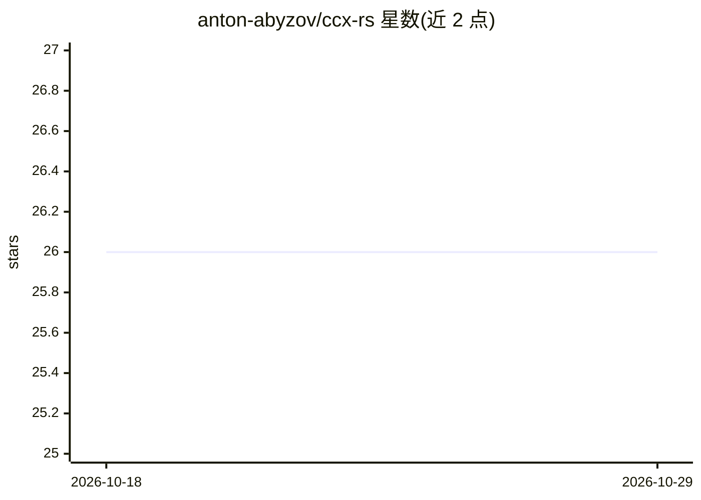

# anton-abyzov/ccx-rs

⭐ 26 · Rust · MIT · 推送 2026-10-26 · [GitHub](https://github.com/anton-abyzov/ccx-rs) · 个人维护

**Rust 编写的终端 AI 编程助手，多模型、免订阅**

CCX-RS 是单文件 4.7MB 二进制的终端 AI 编程助手，用 Rust 实现基于 Ratatui 的 TUI。提供 19 种工具（Bash、文件读写、Grep、子 Agent 派生等）支持并行执行，可通过 Claude API/订阅、OpenRouter（200+ 模型）或 Ollama 本地模型驱动，支持 MCP 外部工具服务器、会话持久化、OAuth 登录、上下文压缩与提示缓存。安装提供 curl 脚本、PowerShell 脚本、cargo 与源码构建四种途径。架构为 14-crate 工作区，含权限 DSL 与 OS 原生沙箱。

## 筛选速览

| 维度 | 判定 | 备注 |
|---|---|---|
| AI 角色 | `ai-native` | 本体是模型或模型工具 |
| 许可风险 | `permissive` | MIT |
| 部署形态 | `desktop` | 安装包/桌面程序 |
| 模型依赖 | local-ok | 支持本地模型 |
| 硬件要求 | — | 无带数字的原话,不猜 |
| 安装摩擦 | `medium` | 含编译或系统依赖之一 |
| 成熟度 | — | 结构信号不足 |

## 能力要点

- 19 种工具并行执行，含子 Agent 派生（Agent/TeamCreate/SendMessage）
- 多模型接入：Claude、OpenRouter 200+ 模型、Ollama 本地
- MCP 外部工具服务器支持（.mcp.json）
- macOS Keychain 读取订阅 token，OAuth 浏览器登录

## 适用场景

- 在终端里让 AI 直接执行命令、编辑文件完成编程任务
- 用 OpenRouter 免费模型或本地 Ollama 跑编程助手而无需订阅
- 通过 MCP 接入外部工具服务器扩展能力

## 场景标签

`编码 Agent` · 领域:编码与开发

## 证据(README 行号)

> L7: **A custom AI coding assistant in a 4.7MB binary.** Free, open-source, multi-model. 19 tools, parallel execution, se
> L85: - **19 tools** -- Bash, FileRead/Write/Edit, Glob, Grep, WebFetch, Agent (spawns sub-agents), TeamCreate, SendMessa
> L87: - **Multi-model** -- Claude (API/subscription), OpenRouter (200+ models), Ollama (local)

## 星数曲线

2026-10-18 26 → 2026-10-29 26（+0）

---
*卡片 v1 · prompt 1.4 · 生成 2026-10-26 · 置信度 high · 依据 README sha `1a83060e3b52` · [字段定义](../../DATASET.md)*
