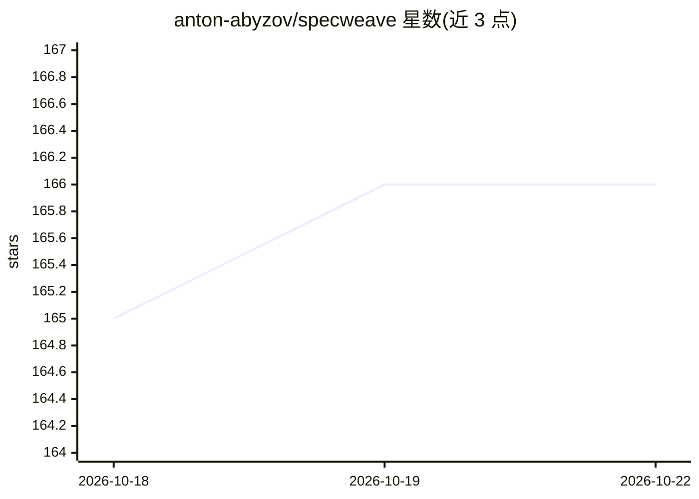

# anton-abyzov/specweave

⭐ 166 · TypeScript · MIT · 推送 2026-10-21 · [GitHub](https://github.com/anton-abyzov/specweave) · [官网](https://spec-weave.com) · 个人维护

**规范优先的 AI 开发工作流 CLI：跨编码代理交接与任务管理**

面向使用 Claude Code、Codex、Grok、Cursor 等编码代理的开发者的 npm CLI：以一个 spec.md 组织功能开发（Problem、验收标准、任务），通过 ledger.jsonl 追加式账本记录任务认领与测试证据，task done 拒绝失败测试；提供 handoff/pickup 命令在不同工具、账号、机器间交接未完成工作，auto-handoff 在用量接近上限时自动交接。含 6 个核心技能与 5 个可选技能（含 GitHub/Jira/Azure DevOps 同步），支持多代理并行与工作区管理。需 Node.js 20.12.0+。

## 筛选速览

| 维度 | 判定 | 备注 |
|---|---|---|
| AI 角色 | `ai-ecosystem` | LLM/agent 周边工具 |
| 许可风险 | `permissive` | MIT |
| 部署形态 | `library` | 以包/库形式分发 |
| 模型依赖 | — | README 未给出锁定关系 |
| 硬件要求 | — | 无带数字的原话,不猜 |
| 安装摩擦 | `low` | 无编译、无系统依赖或容器化 |
| 成熟度 | — | 结构信号不足 |

## 能力要点

- spec.md + ledger.jsonl 的增量式工作流，任务完成需通过测试并留证据
- handoff/pickup 跨工具、账号、机器交接任务，auto-handoff 按用量阈值自动触发
- 6 核心 + 5 可选技能，覆盖 Claude Code、Codex、Grok 等代理
- 可选同步 GitHub/Jira/Azure DevOps，仅在手动运行时调用

## 适用场景

- 在多个 AI 编码工具和账号之间交接未完成的开发任务
- 以验收标准和测试证据驱动 AI 代理自主完成功能开发
- 多代理并行认领任务并保留完整审计账本

## 场景标签

`工作流自动化` · 领域:效率与自动化

## 证据(README 行号)

> L6:  Intent-first development: settle what you want before the code, hand the work between Claude, Codex, Grok and any o
> L21: `init` writes `AGENTS.md` (read by Codex, Grok, Cursor, Gemini and Copilot), a two-line `CLAUDE.md` that imports it
> L77: The CLI is the product and runs in any tool or in CI. The skills expose it to coding agents: `/sw:<name>` in Claude

## 星数曲线

2026-10-18 165 → 2026-10-22 166（+1）

---
*卡片 v1 · prompt 1.4 · 生成 2026-10-22 · 置信度 high · 依据 README sha `70104a210430` · [字段定义](../../DATASET.md)*
