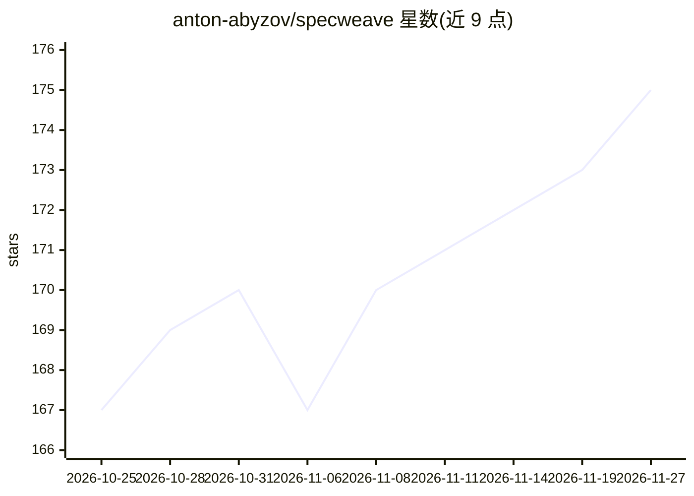

# anton-abyzov/specweave

⭐ 175 · TypeScript · MIT · 推送 2026-11-26 · [GitHub](https://github.com/anton-abyzov/specweave) · [官网](https://spec-weave.com) · 个人维护

**开发团队的 spec 驱动 CLI：跨 AI 编码工具交接任务**

一个 npm 安装的 CLI，把规格（spec.md）、任务与完成证据记录在 git 仓库内，使 Claude Code、Codex、Cursor、Copilot 等编码 agent 能通过 hand off/pick up 两步在不同工具、账号或机器间续接工作。机制包括任务认领与拒绝失败测试的 ledger.jsonl、自动交接阈值、HTML 时间线报告、7 个核心技能与 4 个可选技能（含 GitHub/Jira/Azure DevOps 同步），并支持多 agent 并行与增量自动提交。

## 筛选速览

| 维度 | 判定 | 备注 |
|---|---|---|
| AI 角色 | `ai-ecosystem` | LLM/agent 周边工具 |
| 许可风险 | `permissive` | MIT |
| 部署形态 | `library` | 以包/库形式分发 |
| 模型依赖 | locked-api |  |
| 硬件要求 | — | 无带数字的原话,不猜 |
| 安装摩擦 | `low` | 无编译、无系统依赖或容器化 |
| 成熟度 | `idea` | |

## 能力要点

- hand off/pick up 两步在任意工具/账号/机器间交接任务
- 任务完成须通过测试并将证据存入 ledger.jsonl
- 7 核心+4 可选技能，同一来源适配 Claude Code/Codex/Grok
- 可选同步 GitHub、Jira、Azure DevOps

## 适用场景

- 多人多工具开发时让不同 AI agent 续接同一任务
- 需要规格、验收标准与测试证据留档的团队开发
- 用量耗尽前自动把会话交接给另一个订阅

## 场景标签

`工作流自动化` · 领域:效率与自动化

## 证据(README 行号)

> L6:  Intent-first development: settle what you want before the code, hand the work between Claude, Codex, Grok and any o
> L16: npm install -g specweave        # Node.js 20.12.0+
> L79: The CLI is the product and runs in any tool or in CI. The skills expose it to coding agents: the plugin answers to 

## 星数曲线

2026-10-25 167 → 2026-11-27 175（+8）

---
*卡片 v1 · prompt 1.4 · 生成 2026-11-26 · 置信度 high · 依据 README sha `f927f6e0e19f` · [字段定义](../../DATASET.md)*
