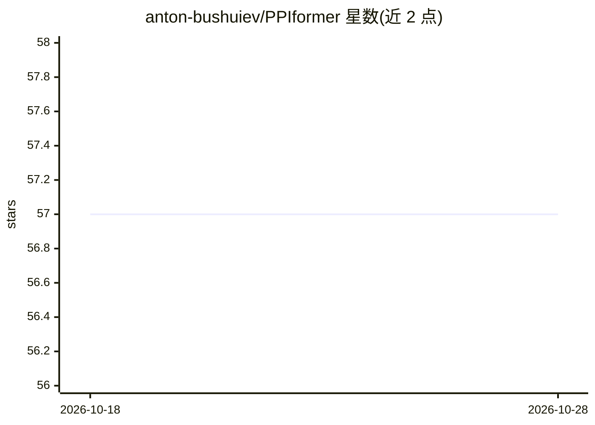

# anton-bushuiev/PPIformer

⭐ 57 · Jupyter Notebook · MIT · 推送 2026-09-19 · [GitHub](https://github.com/anton-bushuiev/PPIformer) · [官网](https://arxiv.org/abs/2310.18515) · 组织维护

**预测突变对蛋白质相互作用结合能影响（ddG）的模型**

PPIformer 是预测氨基酸突变对蛋白质-蛋白质相互作用（PPI）结合能变化（ddG）的机器学习模型。模型在 PPIRef 数据集上以粗粒度结构掩码建模预训练，在 SKEMPI v2.0 上以对数几率微调，可用于 ddG 预测与 PPI 嵌入提取。论文中用于识别葡萄激酶与人抗 SARS-CoV-2 刺突蛋白抗体的已知有利突变。以 Python 包安装，提供 Hugging Face Spaces 在线界面、推理/训练脚本与测试 notebook。

## 筛选速览

| 维度 | 判定 | 备注 |
|---|---|---|
| AI 角色 | `ai-native` | 本体是模型或模型工具 |
| 许可风险 | `permissive` | MIT |
| 部署形态 | `library` | 以包/库形式分发 |
| 模型依赖 | — | README 未给出锁定关系 |
| 硬件要求 | — | 无带数字的原话,不猜 |
| 安装摩擦 | `medium` | 含编译或系统依赖之一 |
| 成熟度 | — | 结构信号不足 |

## 能力要点

- 预测突变对 PPI 结合能的变化（ddG）
- PPIRef 结构掩码建模预训练 + SKEMPI v2.0 微调
- 提供 PPI 嵌入提取（类比 BERT 嵌入）
- 提供 Hugging Face Spaces 在线预览与训练/复现脚本

## 适用场景

- 预测某个突变对蛋白质复合物结合能的影响
- 为蛋白质设计筛选有利的突变候选
- 提取蛋白质相互作用的表征嵌入用于下游任务

## 场景标签

 · 领域:计算生物学/蛋白质工程

## 证据(README 行号)

> L8: PPIformer is a state-of-the-art predictor of the effects of mutations on protein-protein interactions (PPIs), as qua
> L81: The model was pre-trained on the PPIRef dataset via a coarse-grained structural masked modeling and fine-tuned on t

## 星数曲线

2026-10-18 57 → 2026-10-28 57（+0）

---
*卡片 v1 · prompt 1.4 · 生成 2026-10-24 · 置信度 mid · 依据 README sha `37945de5f04d` · [字段定义](../../DATASET.md)*
