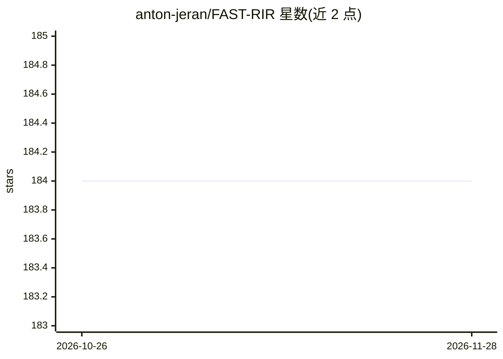

# anton-jeran/FAST-RIR

⭐ 184 · Python · AGPL-3.0 · 推送 2026-11-18 · [GitHub](https://github.com/anton-jeran/FAST-RIR) · [官网](https://anton-jeran.github.io/FRIR/) · 组织维护

**科研工具：神经网络快速生成矩形房间脉冲响应**

ICASSP 2022 论文的官方实现：基于受 StackGAN 启发的神经网络，为给定矩形声学环境生成扩散房间脉冲响应（RIR）。提供 75,000 条 RIR 训练数据集与预训练生成器 checkpoint（经 Zenodo 存档恢复下载），支持预训练模型推理（GPU/CPU 可选）与自行训练。有效生成范围为房间尺寸 8-11m × 6-8m × 2.5-3.5m、混响时间 0.2s-0.7s。Python 环境安装依赖后通过脚本运行。

## 筛选速览

| 维度 | 判定 | 备注 |
|---|---|---|
| AI 角色 | `ai-native` | 本体是模型或模型工具 |
| 许可风险 | `viral` | AGPL-3.0 |
| 部署形态 | `library` | 以包/库形式分发 |
| 模型依赖 | — | README 未给出锁定关系 |
| 硬件要求 | — | 无带数字的原话,不猜 |
| 安装摩擦 | `low` | 无编译、无系统依赖或容器化 |
| 成熟度 | — | 结构信号不足 |

## 能力要点

- 神经网络快速生成矩形房间脉冲响应（RIR）
- 提供 75,000 条 RIR 训练数据集与预训练 checkpoint
- 支持 GPU 推理与 --gpu -1 的 CPU 推理
- 支持使用自有数据集训练模型

## 适用场景

- 为语音识别研究生成不同混响条件的数据增强 RIR
- 在给定房间尺寸与声源/听者位置下生成脉冲响应
- 基于发布的训练数据集复现或继续训练模型

## 场景标签

`科研工具` · 领域:学习与行业

## 证据(README 行号)

> L18: This is the official implementation of our neural-network-based fast diffuse room impulse response generator (**FAS
> L71: python3 main.py --cfg cfg/RIR_eval.yml --gpu 0

## 星数曲线

2026-10-26 184 → 2026-11-28 184（+0）

---
*卡片 v1 · prompt 1.4 · 生成 2026-11-26 · 置信度 high · 依据 README sha `c939f6fcbd94` · [字段定义](../../DATASET.md)*
