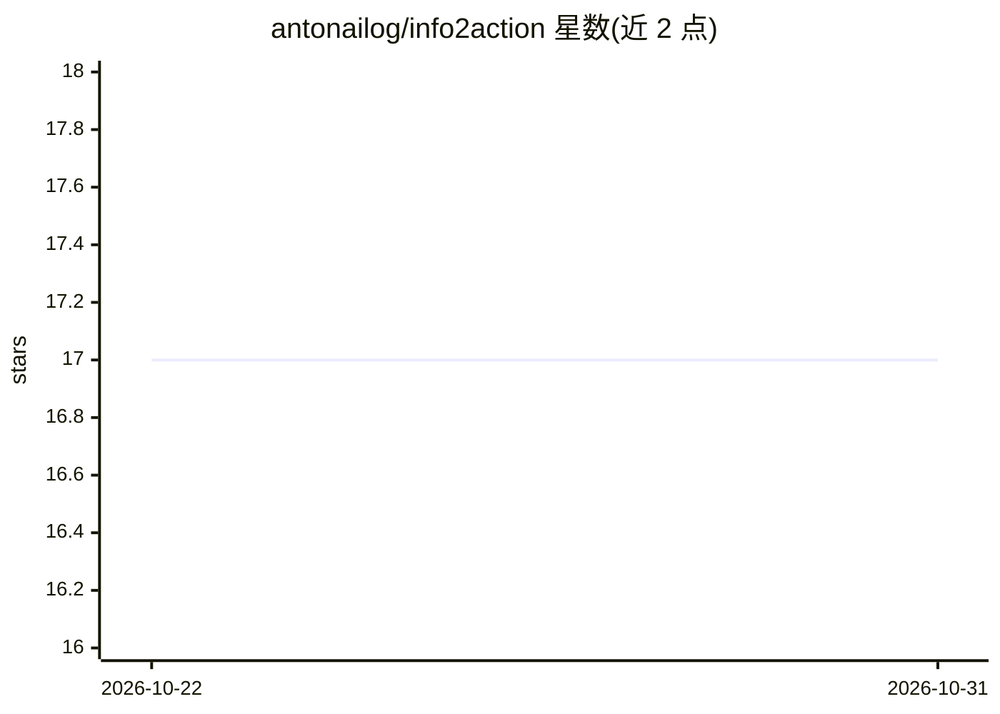

# antonailog/info2action

⭐ 17 · Python · MIT · 推送 2026-10-12 · [GitHub](https://github.com/antonailog/info2action) · [官网](https://info2act.com) · 个人维护 · 中文 README

**可自部署的 AI 信息引擎：多源聚合、跨源去重、信息转行动**

面向个人开发者的自托管信息处理系统：cron 定时从 X、Reddit、RSS、B 站、微信公众号等 10+ 平台采集内容，LLM 产出摘要/分类/评分，embedding 召回 + LLM 精判将同一事件折叠为一条综述事件，再经 LLM verdict 精选，最终把值得做的信号生成可执行行动卡（含自包含 prompt，可交 Claude Code/Codex 执行，支持 Discord 派发）。提供 AI 搜索（多路检索 + 重排 + 长文生成，逐句带角标）与视频 AI 转写。FastAPI + React，SQLite 单机可跑，Supabase 承载多用户生产；prompt 全部开源可改，LLM 走 provider 抽象（MiniMax 默认，可切豆包/OpenAI/DeepSeek）。

## 筛选速览

| 维度 | 判定 | 备注 |
|---|---|---|
| AI 角色 | `ai-native` | 本体是模型或模型工具 |
| 许可风险 | `permissive` | MIT |
| 部署形态 | `library` | 以包/库形式分发 |
| 模型依赖 | — | README 未给出锁定关系 |
| 硬件要求 | — | 无带数字的原话,不猜 |
| 安装摩擦 | `low` | 无编译、无系统依赖或容器化 |
| 成熟度 | — | 结构信号不足 |

## 能力要点

- 多源采集（10+ 平台）+ 两阶段聚类（embedding 召回 + LLM 精判）实现跨源事件去重
- LLM verdict 精选 + 个性化排序（quality × engagement × freshness × match）
- 信息→行动闭环：事件一键生成行动卡与自包含 prompt
- AI 搜索：拆问题→多路检索→Voyage 重排→GLM 写成逐句带角标长文，资料不足不写不扣次数
- 双存储模式：SQLite 单机零依赖，Supabase Postgres + pgvector 多用户生产

## 适用场景

- 每天自动聚合多平台 AI 资讯并折叠重复事件，只读增量
- 把值得做的信息直接转成可执行行动卡派发到 Discord 或交给编码 agent
- 自建带 AI 搜索与视频转写的个人信息流系统

## 场景标签

`知识库管理` `网页抓取` · 领域:效率与自动化

## 证据(README 行号)

> L5: 跨平台聚合 · 跨源事件去重 · AI 精选 · AI 搜索 · 信息→行动闭环
> L23: **Info2Action 想把这件事翻过来**：让 AI 先替你读完全部喧嚣——预读、分类、评分，把散落各处的报道折叠成一条事件——然后只把两样东西交还给你：**值得知道的，和值得去做的**。值得做的那部分，会被翻译成「打开哪个
> L27: **对开发者**：这是一套完整的「多源采集 → LLM 增强 → embedding 召回 + LLM 精判聚类 → 精选评分 → 行动派发」全栈 pipeline 实现。FastAPI + React，SQLite 单机可跑，S

## 星数曲线

2026-10-22 17 → 2026-10-31 17（+0）

---
*卡片 v1 · prompt 1.4 · 生成 2026-10-29 · 置信度 mid · 依据 README sha `827ddb90813d` · [字段定义](../../DATASET.md)*
