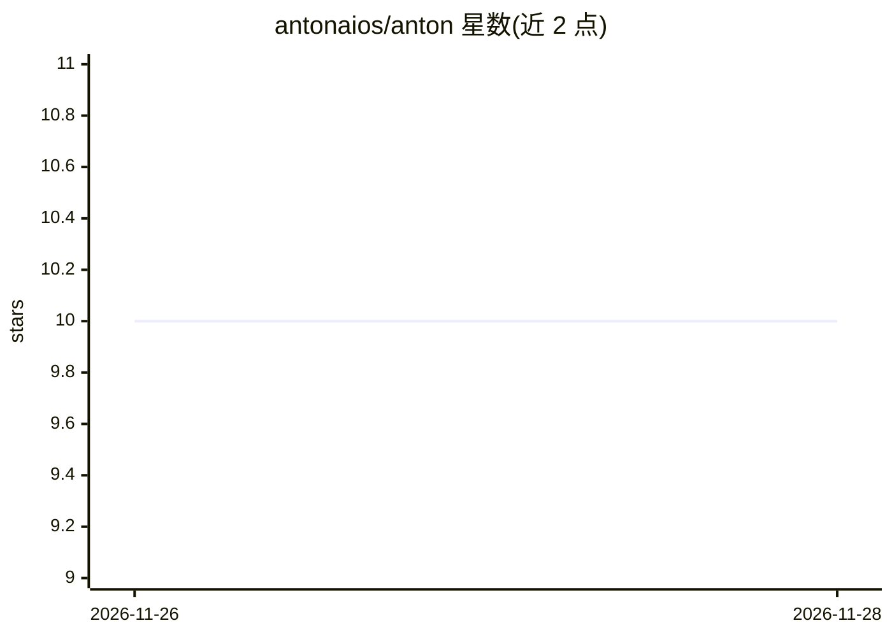

# antonaios/anton

⭐ 10 · Python · MIT · 推送 2026-07-05 · [GitHub](https://github.com/antonaios/anton) · [官网](https://antonaios.github.io/anton) · 个人维护

**面向 M&A 与投资专业人士的本地优先 LLM 操作系统**

将 Obsidian 风格的 Markdown vault 变为可查询知识库，接入确定性估值引擎（LBO/DCF/Comps Excel 模板逐单元格计算）、定时例程层与 React 仪表盘，统一由 FastAPI bridge 暴露约 111 个回环端点。核心机制是 before_llm_call 治理钩子：按四级敏感度分级在调用前决定模型运行位置，Confidential/MNPI 数据默认仅在本机 GPU 上的本地模型处理。四通道派发模型按动词触发并带硬性 token 上限。当前为单人操作系统的公开镜像，处于审阅阶段，无支持 SLA。

## 筛选速览

| 维度 | 判定 | 备注 |
|---|---|---|
| AI 角色 | `ai-native` | 本体是模型或模型工具 |
| 许可风险 | `permissive` | MIT |
| 部署形态 | `library` | 以包/库形式分发 |
| 模型依赖 | local-ok | 支持本地模型 |
| 硬件要求 | `gpu-8g` | |
| 安装摩擦 | `low` | 无编译、无系统依赖或容器化 |
| 成熟度 | `idea` | |

## 能力要点

- 敏感度分级守卫在每次模型调用前决定云端或本地执行，fail-closed 兜底
- 估值计算全部由确定性 Python 引擎驱动 Excel 模板，LLM 不计算数字
- 四通道派发（Chat/Single Skill/Composite/Autonomous Crew）带 token 与时限上限
- 所有模型调用生成结构化遥测记录：模型、token 成本、敏感度层级与通道

## 适用场景

- 在保密前提下用 AI 分析 CIM/VDR 文档并起草投委会备忘录
- M&A 交易中约束 LLM 成本与执行路径
- 以 Markdown vault 为中心整合邮件、新闻与会议纪要

## 场景标签

`知识库管理` `金融量化` `文档问答` · 领域:知识与检索

## 证据(README 行号)

> L34: instinct: **an operator‑led LLM OS for M&A and investment professionals, designed to work alongside you — with audi
> L43: |**Data Confidentiality**|**Opaque Cloud Risk:** Relies on generic cloud privacy policies; high operational risk of

## 星数曲线

2026-11-26 10 → 2026-11-28 10（+0）

---
*卡片 v1 · prompt 1.4 · 生成 2026-11-26 · 置信度 low · 依据 README sha `1efcd24f572d` · [字段定义](../../DATASET.md)*
