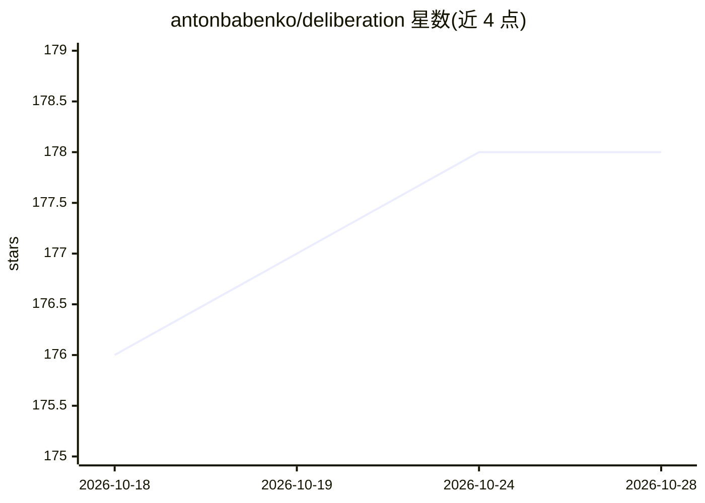

# antonbabenko/deliberation

⭐ 178 · JavaScript · MIT · 推送 2026-10-28 · [GitHub](https://github.com/antonbabenko/deliberation) · 个人维护

**让编码代理向 GPT/Gemini/Grok 等多模型征求二次意见与共识的 MCP 服务器**

一个跨主机通用的 MCP 服务器与插件集：让 Claude Code、Codex、Cursor、Kiro、OpenCode 等编码代理把问题委托给 GPT、Gemini、Grok、本地模型（Ollama、LM Studio）及 OpenRouter 的 400+ 模型（含 Qwen、Kimi、DeepSeek）。提供七位领域专家角色、多轮收敛共识循环、逐模型延迟/Token/裁决一致性分析，以及可选的本地只读仪表盘。各 provider 按已配置情况自动检测与路由；OpenRouter 需在 config.json 中声明模型。以 Claude Code 插件、npm 包（npx 启动独立服务器）及 Docker 镜像三种方式分发。

## 筛选速览

| 维度 | 判定 | 备注 |
|---|---|---|
| AI 角色 | `ai-ecosystem` | LLM/agent 周边工具 |
| 许可风险 | `permissive` | MIT |
| 部署形态 | `self-host` | docker 或自建部署 |
| 模型依赖 | local-ok | 支持本地模型 |
| 硬件要求 | — | 无带数字的原话,不猜 |
| 安装摩擦 | `low` | 无编译、无系统依赖或容器化 |
| 成熟度 | — | 结构信号不足 |

## 能力要点

- 七位领域专家（架构师、代码评审、安全分析等）审阅方案并多轮辩论至收敛
- 接入 GPT/Gemini/Grok、本地模型与 OpenRouter 400+ 模型，自动检测已配置 provider 并路由
- ask-all/consensus 等工具输出分歧矩阵与逐模型延迟、Token、裁决一致性分析
- 可选本地仪表盘：时间线可视化运行、历史、用量统计与模型健康分析

## 适用场景

- 在编码代理中让多个模型交叉评审方案、找 bug 并达成共识
- 为不同问题类型（架构、安全、调试）路由到对应专家模型
- 用仪表盘跟踪各模型的延迟与一致性，决定保留哪些模型

## 场景标签

`多智能体` `代码审查` · 领域:Agent 开发

## 证据(README 行号)

> L40: OpenAI-compatible model (via OpenRouter) for help through MCP. Deliberation handles the wiring
> L44: It is not tied to Claude Code. The same MCP server runs on any MCP host, and Codex, Cursor,
> L145: Tools exposed: `ask-all`, `consensus` (the full convergence loop in one call, or a single synthesis pass with `syn

## 星数曲线

2026-10-18 176 → 2026-10-28 178（+2）

---
*卡片 v1 · prompt 1.4 · 生成 2026-10-23 · 置信度 high · 依据 README sha `d6e48f099e1a` · [字段定义](../../DATASET.md)*
