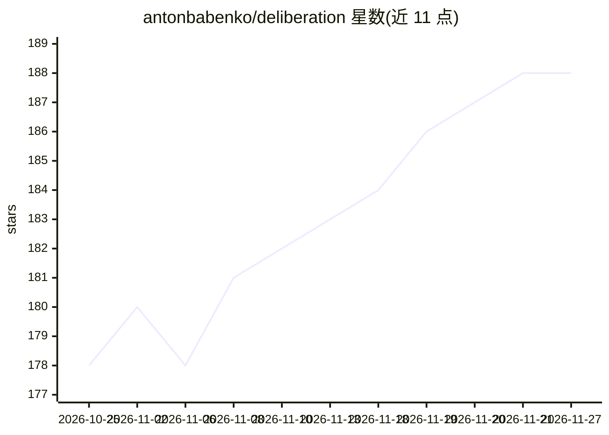

# antonbabenko/deliberation

⭐ 188 · JavaScript · MIT · 推送 2026-11-26 · [GitHub](https://github.com/antonbabenko/deliberation) · [官网](https://usedeliberation.com/) · 个人维护

**为编码 agent 提供跨模型多评审共识的 MCP 服务器**

Deliberation 是一个 MCP 服务器和 Claude Code 插件：在 /consensus 流程中，宿主 agent 先记录自身判断，再由 GPT、Gemini、Grok、本地模型及 OpenRouter 400+ 模型独立评审同一计划，经仲裁与多轮收敛产出一份结论，异议保留在报告中。内置 8 个领域专家角色（架构师、代码评审、安全分析等）与自动路由；附带本地仪表盘展示运行时间线、历史、统计，分析器按模型延迟、token、一致度标记可淘汰模型。需至少一个 provider：codex/agy CLI、xAI 或 OpenRouter key、或 Ollama/LM Studio 本地模型；只有 Gemini 可实施代码修改。

## 筛选速览

| 维度 | 判定 | 备注 |
|---|---|---|
| AI 角色 | `ai-ecosystem` | LLM/agent 周边工具 |
| 许可风险 | `permissive` | MIT |
| 部署形态 | `self-host` | docker 或自建部署 |
| 模型依赖 | local-ok | 支持本地模型 |
| 硬件要求 | — | 无带数字的原话,不猜 |
| 安装摩擦 | `low` | 无编译、无系统依赖或容器化 |
| 成熟度 | — | 结构信号不足 |

## 能力要点

- 跨厂商仲裁共识流程：agent 先盲判、外部模型独立评审、异议保留
- 8 个领域专家角色与自动路由，双模式（只读分析或实施）
- 本地仪表盘：运行时间线、历史、provider 健康与用量统计
- 内置分析器报告每模型延迟/token/一致度并标记 drop 候选

## 适用场景

- 提交 diff 前让多个模型交叉评审真实 bug、安全问题与缺失测试
- 让三个模型互相辩论并查看分歧矩阵以确定优先修复项
- 用分析器评估哪些参与模型贡献不足并淘汰
- 在 Claude Code、Codex、Cursor、Gemini CLI 等多个宿主中使用同一评审服务

## 场景标签

`多智能体` `代码审查` · 领域:Agent 开发

## 证据(README 行号)

> L10: Deliberation is an MCP server and Claude Code plugin. In `/consensus`, your agent records its own verdict before it
> L83: It is not tied to Claude Code. The same MCP server runs on any MCP host, and Codex, Cursor,
> L88: You can use any subset of the providers. Deliberation detects which are configured and routes

## 星数曲线

2026-10-25 178 → 2026-11-27 188（+10）

---
*卡片 v1 · prompt 1.4 · 生成 2026-11-26 · 置信度 mid · 依据 README sha `535ac9e33f31` · [字段定义](../../DATASET.md)*
