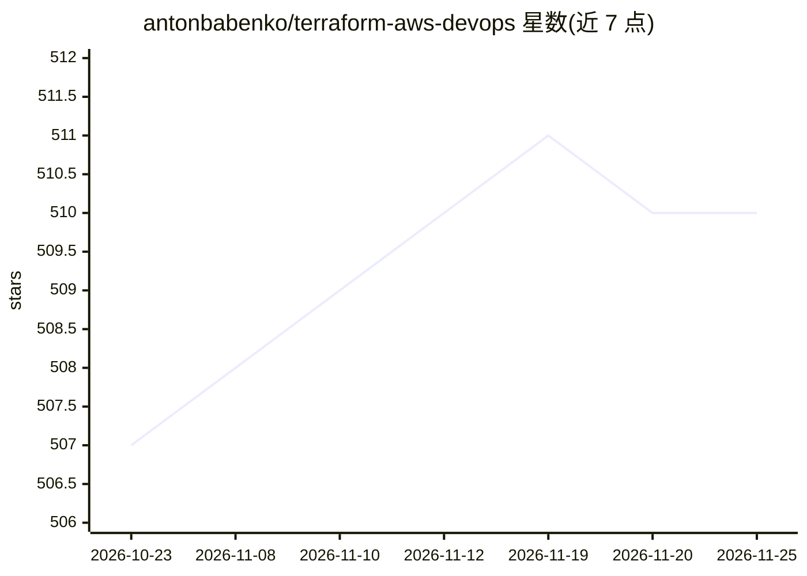

# antonbabenko/terraform-aws-devops

⭐ 510 · 推送 2026-11-04 · [GitHub](https://github.com/antonbabenko/terraform-aws-devops) · [官网](https://github.com/sponsors/antonbabenko) · 个人维护

**面向 DevOps 工程师的 Terraform/AWS 项目链接目录**

作者 antonbabenko 的个人项目链接集合，索引其 Terraform、AWS、DevOps 相关项目：媒体项目（YouTube 直播、weekly.tf 通讯）、大型项目（compliance.tf 合规模块、terraform-aws-modules、serverless.tf、terraform-best-practices 电子书）、AI 相关工具（deliberation、modules.tf、terraform-skill）及实用工具。仓库本身不提供安装与运行方式，仅以链接导航组织内容。

## 筛选速览

| 维度 | 判定 | 备注 |
|---|---|---|
| AI 角色 | `ai-knowledge` | 知识聚合/清单类 |
| 许可风险 | `none` | — |
| 部署形态 | `None` |  |
| 模型依赖 | — | README 未给出锁定关系 |
| 硬件要求 | — | 无带数字的原话,不猜 |
| 安装摩擦 | `low` | 无编译、无系统依赖或容器化 |
| 成熟度 | — | 结构信号不足 |

## 能力要点

- 收录 60+ 模块、电子书、通讯等多个 Terraform 项目入口
- 包含 deliberation 多模型专家评审与 modules.tf PR 审查工具链接
- terraform-best-practices 电子书提供 20+ 语言翻译

## 适用场景

- 查找 Terraform/AWS 相关开源项目与学习资源入口
- 了解该作者的 Terraform 工具与媒体项目全貌

## 场景标签

`精选清单` · 领域:学习与行业

## 证据(README 行号)

> L1: # Various links to most of my Terraform, AWS, and DevOps projects
> L50: ## Big projects
> L98: ### deliberation - A second opinion from other AI models

## 星数曲线

2026-10-23 507 → 2026-11-25 510（+3）

---
*卡片 v1 · prompt 1.4 · 生成 2026-11-25 · 置信度 high · 依据 README sha `b7ce22f84fda` · [字段定义](../../DATASET.md)*
