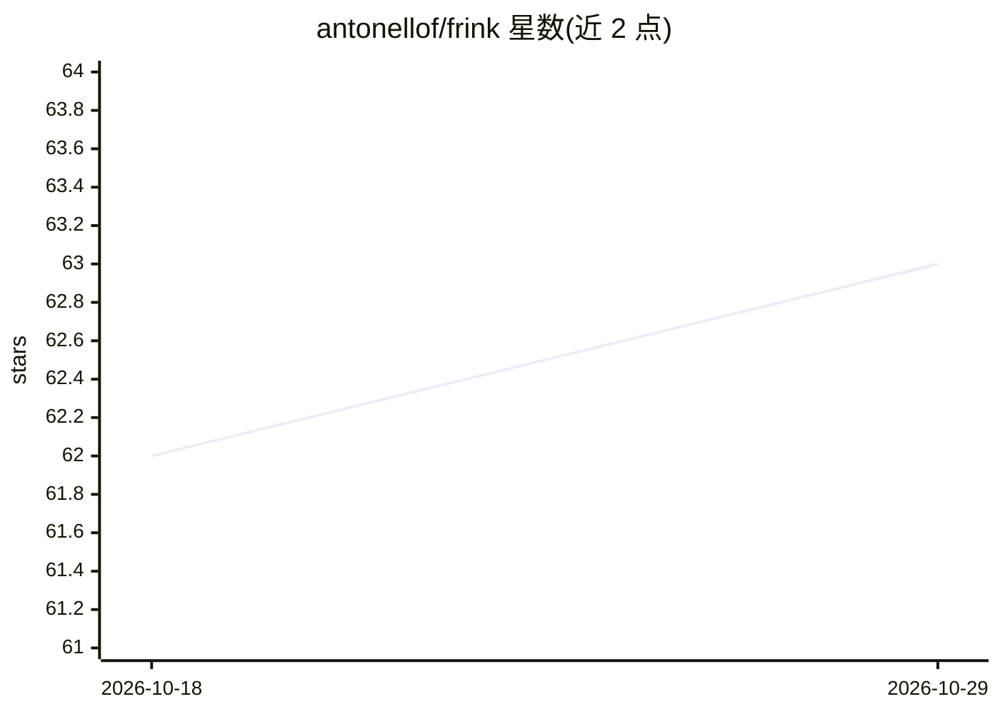

# antonellof/frink

⭐ 63 · Rust · NOASSERTION · 推送 2026-10-28 · [GitHub](https://github.com/antonellof/frink) · [官网](https://www.fratepietro.com/2026/frink-rust-alternative-to-llama-cpp/) · 个人维护

**纯 Rust 编写的 GGUF 推理引擎，提供 OpenAI 兼容服务**

用 Rust 从零实现 GGUF 模型加载、量化内核与 MoE 专家路由，不链接 llama.cpp/GGML，单二进制（macOS arm64 约 23 MB）内含补全、API 服务、download/bench/quantize/imatrix/gguf-split/verify 等工具。支持 CPU、Apple Metal、CUDA 后端，量化覆盖 K-quants、IQ 系列、MXFP4、F16/BF16。提供 OpenAI 兼容服务器（连续批处理、分页 KV、投机解码、GBNF 结构化输出、11 种工具调用格式），另含 Frink Studio 网页 UI。CLI 兼容 llama.cpp 的旗标与工具语义，量化输出与 llama-quantize 字节一致。限 macOS arm64 与 Linux x86_64 预编译。

## 筛选速览

| 维度 | 判定 | 备注 |
|---|---|---|
| AI 角色 | `ai-ecosystem` | LLM/agent 周边工具 |
| 许可风险 | `permissive` | NOASSERTION |
| 部署形态 | `library` | 以包/库形式分发 |
| 模型依赖 | local-ok | 支持本地模型 |
| 硬件要求 | — | 无带数字的原话,不猜 |
| 安装摩擦 | `medium` | 含编译或系统依赖之一 |
| 成熟度 | — | 结构信号不足 |

## 能力要点

- 纯 Rust 实现的 GGUF 加载器、量化内核与 MoE 路由，不依赖 GGML
- OpenAI 兼容服务器：连续批处理、分页 KV、无损投机解码、运行时换模
- 逐 token 强制的结构化输出（GBNF 语法 / 工具 schema）
- 兼容 llama.cpp 旗标与工具链，quantize 输出与 llama-quantize 字节一致

## 适用场景

- 在本地 CPU/Metal/CUDA 硬件上运行 GGUF 大模型并提供 OpenAI 兼容 API
- 以 Rust 库形式把 GGUF 推理嵌入自己的项目
- 本地运行 BGE/E5/GTE 编码器提供 embeddings 与 rerank 服务
- 为 agent 应用提供带结构化输出与工具调用的本地推理后端

## 场景标签

`推理引擎` · 领域:训练与推理

## 证据(README 行号)

> L25: Frink loads GGUF checkpoints and runs them on the hardware you already
> L47: - **OpenAI-compatible server.** On Metal, multiple concurrent clients

## 星数曲线

2026-10-18 62 → 2026-10-29 63（+1）

---
*卡片 v1 · prompt 1.4 · 生成 2026-10-24 · 置信度 mid · 依据 README sha `d709755910c5` · [字段定义](../../DATASET.md)*
