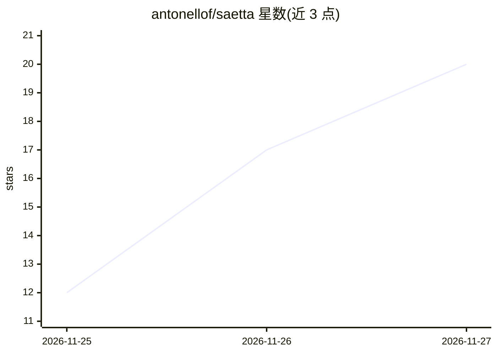

# antonellof/saetta

⭐ 20 · C · NOASSERTION · 推送 2026-11-26 · [GitHub](https://github.com/antonellof/saetta) · [官网](https://saetta.dev) · 个人维护

**Mac 本地编码 agent 运行时：单二进制内置推理引擎跑开源编码模型**

用 C 与手写 Metal 在 Apple Silicon 上实现的本地编码 agent：推理引擎与 agent 框架合一，模型在 agent 进程内运行，agent 与模型间无服务器与 HTTP。它是 pi 编码 agent 1.5.2 的 C 语言移植，复用其工具、系统提示、AGENTS.md/CLAUDE.md、skills、会话与配置文件，并提供 Claude Code/pi/opencode 接入与 OpenAI/Anthropic 兼容 API。按 Mac 内存自动选型下载模型包。限制：需 M1+ 且 32 GB 以上内存、macOS 26+，不支持 pi 的 TypeScript 扩展与图像输入。

## 筛选速览

| 维度 | 判定 | 备注 |
|---|---|---|
| AI 角色 | `ai-ecosystem` | LLM/agent 周边工具 |
| 许可风险 | `none` | NOASSERTION |
| 部署形态 | `None` |  |
| 模型依赖 | — | README 未给出锁定关系 |
| 硬件要求 | — | 无带数字的原话,不猜 |
| 安装摩擦 | `medium` | 含编译或系统依赖之一 |
| 成熟度 | — | 结构信号不足 |

## 能力要点

- 单 2.3 MB 二进制，无 Node.js/Python 依赖，内核针对 agent 负载（长共享前缀、短回答、工具调用）
- 按内存自动匹配模型包：coder(96GB)/27b-turbo(36GB)/27b-4bit(32GB) 等，含 LoRA 适配器与编码微调
- 字节级对齐 pi：63 个请求/会话场景与 75 个交互界面场景比对
- MCP 服务器支持（stdio/Streamable HTTP）与多 agent 并行子任务（--subagents）

## 适用场景

- 在 Mac 上离线运行本地编码 agent 改代码、写页面、跑测试
- 让本地模型驱动已有的 Claude Code/pi/opencode 配置
- 用 OpenAI 兼容端点把本地模型接入其他客户端

## 场景标签

`编码 Agent` `推理引擎` · 领域:编码与开发

## 证据(README 行号)

> L4:  Two families of open coding models, Qwen3.8 and Inkling 2 Mini, run inside the agent on its own inference engine, w
> L62: Saetta Code is the coding agent inside the `saetta` binary. It is written in C and runs the model in its own proces
> L122: `saetta start` joins the server on this machine or starts one, waits for the model and runs the agent pointed at i

## 星数曲线

2026-11-25 12 → 2026-11-27 20（+8）

---
*卡片 v1 · prompt 1.4 · 生成 2026-11-24 · 置信度 high · 依据 README sha `3567168171be` · [字段定义](../../DATASET.md)*
