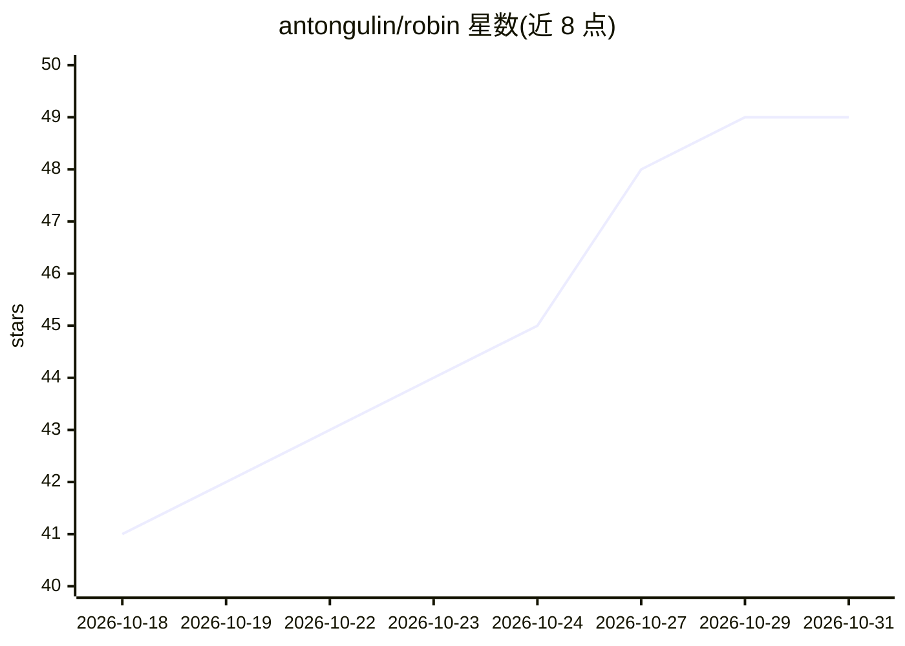

# antongulin/robin

⭐ 49 · TypeScript · MIT · 推送 2026-10-30 · [GitHub](https://github.com/antongulin/robin) · [官网](https://www.robinreview.dev) · 个人维护

**自托管 GitHub Action AI 代码审查机器人，自带 API key**

以 GitHub Action 可复用工作流形式运行在用户自己仓库中的 AI PR 审查机器人：PR 打开或评论 /robin 时触发，输出总结、行内评论与一键建议修复；可选 agent 模式让支持工具调用的模型读取全仓上下文（文件、调用方、目录）后再判定问题。密钥与 LLM 端点通过 GitHub Secrets 配置，支持 OpenRouter（含免费模型路由）、OpenAI、Anthropic、Groq、Ollama 等多种提供商；安装经 npx robin-review 或 curl 脚本完成，并可向编辑器编码代理安装伴随技能。无独立服务注册，仅消耗 GitHub Actions 分钟数。

## 筛选速览

| 维度 | 判定 | 备注 |
|---|---|---|
| AI 角色 | `ai-native` | 本体是模型或模型工具 |
| 许可风险 | `permissive` | MIT |
| 部署形态 | `library` | 以包/库形式分发 |
| 模型依赖 | local-ok | 支持本地模型 |
| 硬件要求 | — | 无带数字的原话,不猜 |
| 安装摩擦 | `low` | 无编译、无系统依赖或容器化 |
| 成熟度 | — | 结构信号不足 |

## 能力要点

- PR 触发审查：总结、行内评论与一键建议修复
- agent 模式（agent-mode: auto）支持模型读取全仓上下文的多轮调查，不支持工具时回退 diff-only
- BYOK 多提供商支持：OpenRouter/OpenAI/Anthropic/Groq/Ollama，OpenRouter 免费模型 $0
- 一行安装器同时生成工作流并向编码代理（Claude Code/Cursor/Copilot 等）安装伴随技能

## 适用场景

- 给自己的仓库配一个免订阅费的 AI PR 审查机器人
- 用 OpenRouter 免费模型实现零成本代码审查
- 在自托管 runner（Mac mini/家庭服务器/Coolify）上运行审查
- 让编辑器里的编码代理走审查-修复-回复-复审循环

## 场景标签

`代码审查` · 领域:编码与开发

## 证据(README 行号)

> L13: - A review when you open a pull request (or when someone comments `/robin`)
> L15: - Optional reviews that check the rest of your repo (callers, definitions) when you enable agent mode and your mode
> L94: Other providers (OpenAI, Groq, Ollama, etc.) work too. See Supported providers or docs/ADVANCED.md.

## 星数曲线

2026-10-18 41 → 2026-10-31 49（+8）

---
*卡片 v1 · prompt 1.4 · 生成 2026-10-25 · 置信度 high · 依据 README sha `420bc7166e24` · [字段定义](../../DATASET.md)*
