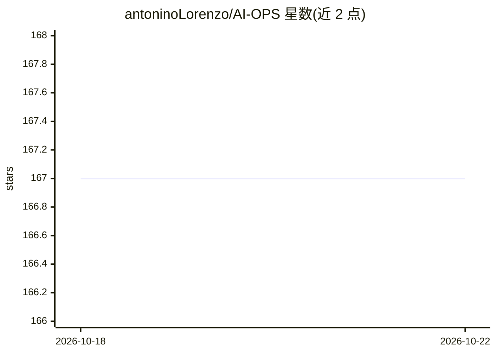

# antoninoLorenzo/AI-OPS

⭐ 167 · Python · MIT · 推送 2026-10-21 · [GitHub](https://github.com/antoninoLorenzo/AI-OPS) · [官网](https://antoninolorenzo.github.io/AI-OPS/) · 个人维护

**自带 LLM 的渗透测试 AI agent，API+CLI 驱动**

面向渗透测试与网络安全任务的开源 agent：由容器化 HTTP API 服务承载 agent、工具与会话状态，通过终端 CLI 交互使用，也可从 Python 库直接调用做自动化与基准测试。LLM 外置且自选，底层用 litellm 支持托管服务商、OpenAI 兼容端点或自托管模型，设计面向中等规模模型。命令执行受可配置 allow-list 策略约束，可选 MLflow 追踪。README 声明其为实验性工具，限定学术与教育用途。

## 筛选速览

| 维度 | 判定 | 备注 |
|---|---|---|
| AI 角色 | `ai-native` | 本体是模型或模型工具 |
| 许可风险 | `permissive` | MIT |
| 部署形态 | `self-host` | docker 或自建部署 |
| 模型依赖 | — | README 未给出锁定关系 |
| 硬件要求 | — | 无带数字的原话,不猜 |
| 安装摩擦 | `low` | 无编译、无系统依赖或容器化 |
| 成熟度 | `idea` | |

## 能力要点

- 模型无关：经 litellm 接入任意 provider、OpenAI 兼容端点或自托管模型
- 容器化 API + CLI 两种使用方式，亦可作为 Python 库直接调用
- 命令执行受 allow-list 策略守护，未列入需确认
- 可复用 Skills 剧本并可自行扩展

## 适用场景

- 在预装攻击工具的容器中运行 LLM 辅助的渗透测试 agent
- 通过 CLI 交互式驱动安全任务会话
- 用 Python 库形式做自动化与基准测试

## 场景标签

`网络安全` · 领域:学习与行业

## 证据(README 行号)

> L3:  LLM-assisted penetration-testing agent. Bring your own LLM, run the API, drive it from the CLI.
> L14: AI-OPS is an open agent for penetration-testing and cybersecurity tasks. You run the agent behind an HTTP API, in a

## 星数曲线

2026-10-18 167 → 2026-10-22 167（+0）

---
*卡片 v1 · prompt 1.4 · 生成 2026-10-22 · 置信度 high · 依据 README sha `ecbfc3b14526` · [字段定义](../../DATASET.md)*
