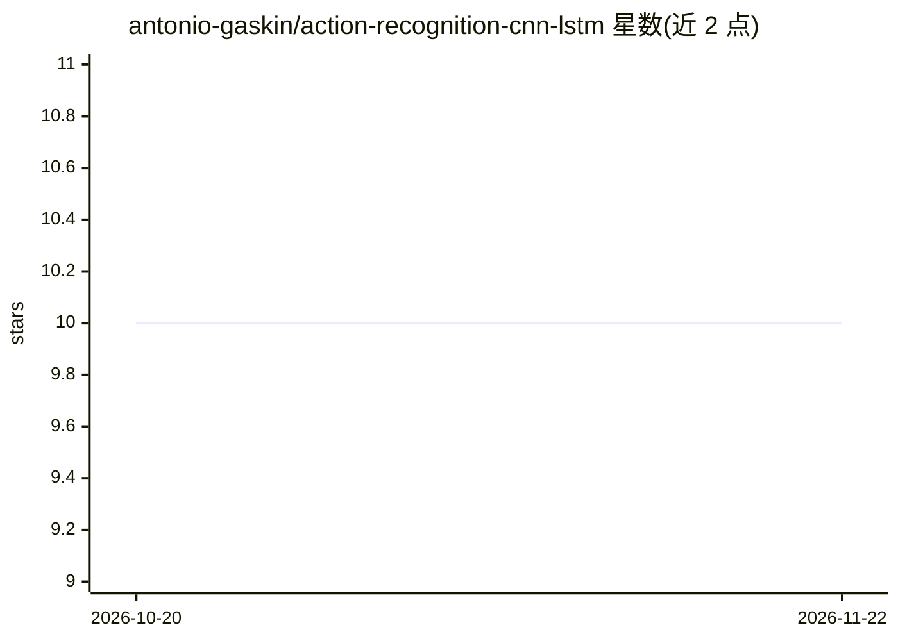

# antonio-gaskin/action-recognition-cnn-lstm

⭐ 10 · Jupyter Notebook · 推送 2026-08-06 · [GitHub](https://github.com/antonio-gaskin/action-recognition-cnn-lstm) · 个人维护

**融合 ConvLSTM 与 LSTM 的骨架动作识别模型实现**

基于姿态骨架特征的动作识别项目：用 MediaPipe 检测追踪人体姿态，将 ConvLSTM 与 LSTM 两种架构融合，检测 10 种美国手语（ASL）动作，在自定义 ASL 数据集上报告 0.901 测试准确率；并在 UCF-YouTube Action 数据集上训练以作对比，报告 0.77 测试准确率。README 提供 Kaggle 数据集链接及模型、结果章节（准确率/损失曲线、混淆矩阵），未给出安装或运行说明。

## 筛选速览

| 维度 | 判定 | 备注 |
|---|---|---|
| AI 角色 | `ai-native` | 本体是模型或模型工具 |
| 许可风险 | `none` | — |
| 部署形态 | `None` |  |
| 模型依赖 | — | README 未给出锁定关系 |
| 硬件要求 | — | 无带数字的原话,不猜 |
| 安装摩擦 | `low` | 无编译、无系统依赖或容器化 |
| 成熟度 | — | 结构信号不足 |

## 能力要点

- 融合 ConvLSTM 与 LSTM 的动作识别架构
- 基于 MediaPipe 人体姿态骨架特征
- 支持 ASL 数据集（10 类）与 UCF-YouTube Action 数据集
- README 报告混淆矩阵、准确率与损失曲线

## 适用场景

- 识别美国手语动作视频
- 在视频动作分类任务中复现骨架特征方案

## 场景标签

`目标检测` · 领域:感知与多模态

## 证据(README 行号)

> L6: Action recognition is a challenging problem in deep learning. With the advancement in Deep Learning, ConvLSTM (8) an
> L10: American Sign Language (ASL) is widely spread within the deaf community as the primary source of communication with

## 星数曲线

2026-10-20 10 → 2026-11-22 10（+0）

---
*卡片 v1 · prompt 1.4 · 生成 2026-11-20 · 置信度 high · 依据 README sha `3006355521a3` · [字段定义](../../DATASET.md)*
