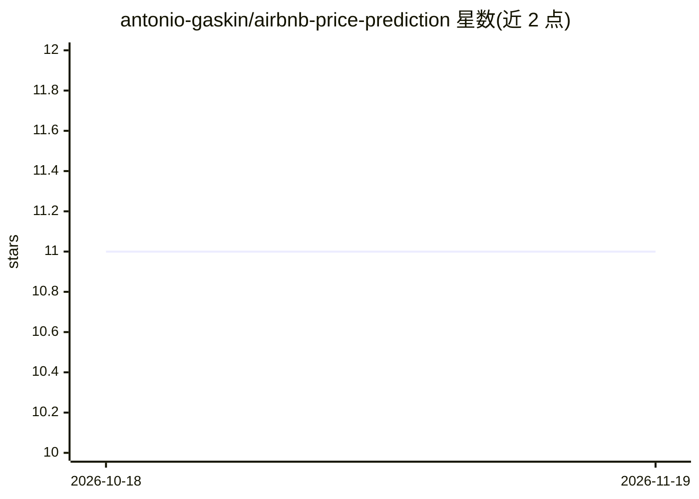

# antonio-gaskin/airbnb-price-prediction

⭐ 11 · Python · MIT · 推送 2026-08-06 · [GitHub](https://github.com/antonio-gaskin/airbnb-price-prediction) · 个人维护

**面向开发者的柏林 Airbnb 房价预测端到端 ML 项目**

以柏林 InsideAirbnb 数据为输入的端到端机器学习项目：src/clean.py 完成数据清洗与特征表构建，scikit-learn 管线（插补、缩放/独热编码、RandomForest）训练基线回归模型并保存带元数据的工件，FastAPI 服务暴露 /predict 与 /predict_batch 接口并提供 Pydantic 校验。附 pytest 测试、CI/CD 工作流、Power BI 仪表板报告与 Excel 导出脚本。README 说明该项目用于展示 ML 工程技能以申请德国的数据/ML 实习岗位。基线模型给出 RMSE 73.63、MAE 41.21、R² 0.47 的指标。

## 筛选速览

| 维度 | 判定 | 备注 |
|---|---|---|
| AI 角色 | `ai-native` | 本体是模型或模型工具 |
| 许可风险 | `permissive` | MIT |
| 部署形态 | `self-host` | docker 或自建部署 |
| 模型依赖 | — | README 未给出锁定关系 |
| 硬件要求 | — | 无带数字的原话,不猜 |
| 安装摩擦 | `low` | 无编译、无系统依赖或容器化 |
| 成熟度 | — | 结构信号不足 |

## 能力要点

- 数据清洗、scikit-learn 训练、FastAPI 预测服务的完整管线
- Dockerfile 与 docker-compose 打包 API 服务
- pytest 单元测试覆盖清洗、训练与 API 端点
- GitHub Actions CI/CD 构建并推送镜像到 GHCR

## 适用场景

- 学习房价回归模型的端到端工程实践
- 部署一个提供单条/批量预测的 REST API 服务
- 参考数据清洗与特征工程的具体实现
- 复现从原始 CSV 到模型工件到 Docker 部署的流程

## 场景标签

 · 领域:机器学习/数据科学

## 证据(README 行号)

> L3: End‑to‑end ML project that predicts nightly Airbnb prices in **Berlin**. It includes data cleaning, a baseline regre
> L8: - **Model training**: `src/models/train.py` builds a scikit‑learn pipeline (impute → scale/one‑hot → RandomForest) a
> L9: - **API service**: `src/api/__init__.py` exposes `/predict` and `/predict_batch` with **FastAPI** and Pydantic valid

## 星数曲线

2026-10-18 11 → 2026-11-19 11（+0）

---
*卡片 v1 · prompt 1.4 · 生成 2026-11-18 · 置信度 high · 依据 README sha `30051df89e43` · [字段定义](../../DATASET.md)*
