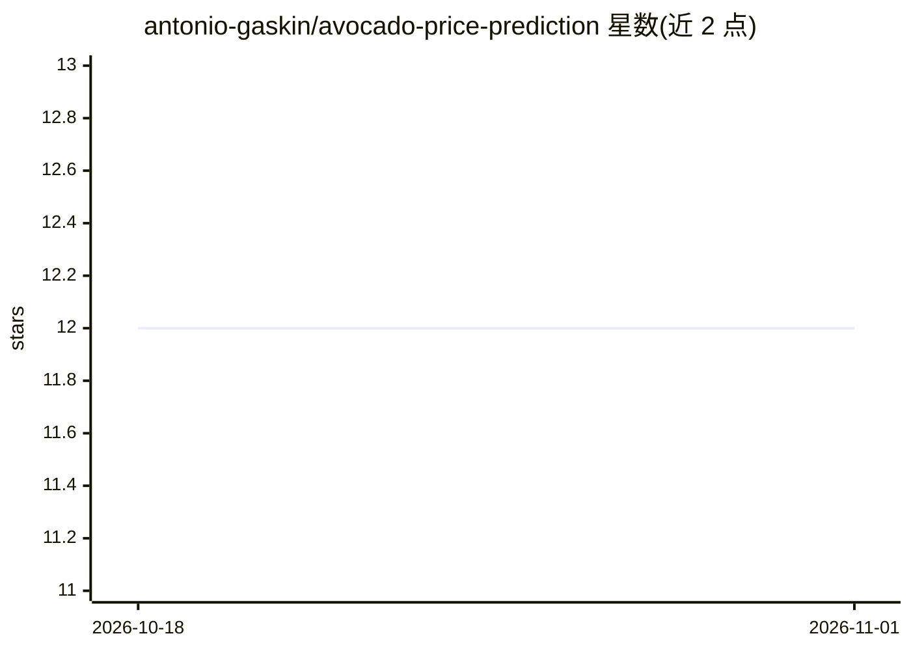

# antonio-gaskin/avocado-price-prediction

⭐ 12 · Jupyter Notebook · 推送 2026-08-06 · [GitHub](https://github.com/antonio-gaskin/avocado-price-prediction) · 个人维护

**用 FbProphet 预测牛油果零售价格的数据分析项目**

基于 2015-2018 年美国哈斯牛油果周度零售扫描数据（来自零售商收银系统的实际销量与均价），使用 Facebook Prophet 进行时间序列价格预测，并生成 2019 年均价预测与年度、月度价格趋势图，以及销售量与均价的可视化。数据含常规/有机两种类型、多个地区与 PLU 销量列。README 以结果展示为主，未给出安装或运行命令，代码形式为 Jupyter/脚本类分析项目。

## 筛选速览

| 维度 | 判定 | 备注 |
|---|---|---|
| AI 角色 | `ai-native` | 本体是模型或模型工具 |
| 许可风险 | `none` | — |
| 部署形态 | `None` |  |
| 模型依赖 | — | README 未给出锁定关系 |
| 硬件要求 | — | 无带数字的原话,不猜 |
| 安装摩擦 | `low` | 无编译、无系统依赖或容器化 |
| 成熟度 | — | 结构信号不足 |

## 能力要点

- 基于真实零售扫描数据的周度均价与销量分析
- FbProphet 时间序列预测 2019 年均价
- 含 2015-2018 销量与均价可视化及年/月趋势图

## 适用场景

- 学习 FbProphet 时间序列预测的入门示例
- 分析牛油果零售价格季节性趋势
- 复现 2019 年价格预测实验

## 场景标签

`数据分析` · 领域:效率与自动化

## 证据(README 行号)

> L1: # Avocado Price Prediction using FbProphet
> L31: Average Unit Price forecast for the year 2019.

## 星数曲线

2026-10-18 12 → 2026-11-01 12（+0）

---
*卡片 v1 · prompt 1.4 · 生成 2026-11-01 · 置信度 mid · 依据 README sha `79abff567b57` · [字段定义](../../DATASET.md)*
