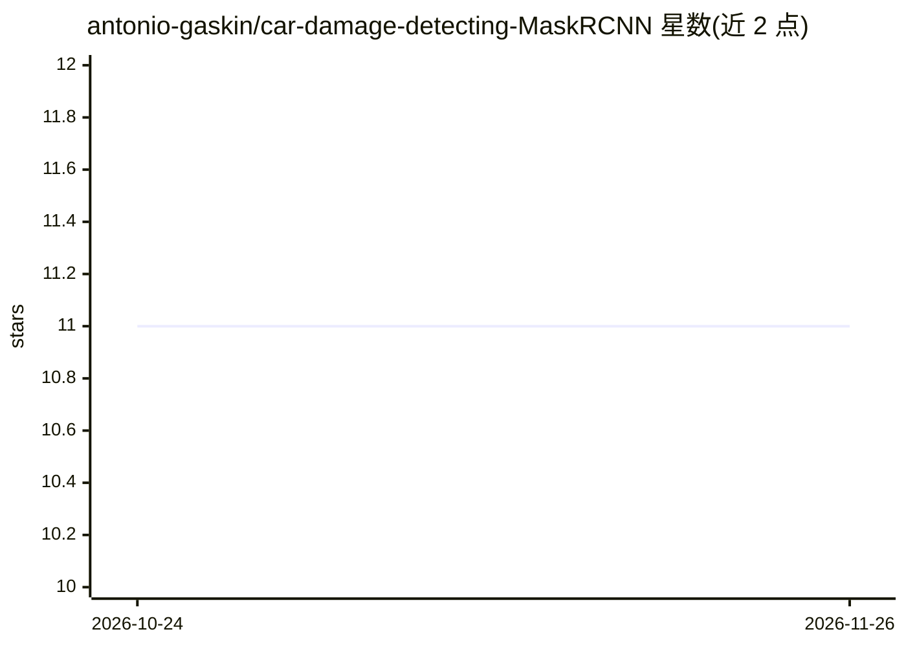

# antonio-gaskin/car-damage-detecting-MaskRCNN

⭐ 11 · Python · Apache-2.0 · 推送 2026-08-06 · [GitHub](https://github.com/antonio-gaskin/car-damage-detecting-MaskRCNN) · 个人维护

**检测四类车辆损伤并估算维修成本的 Flask Web 应用**

基于 Mask R-CNN 的车辆损伤检测项目：识别 Scratch、Dent、Dislocation、Shatter 四类损伤并生成分割掩码，按掩码与图像面积比给出参考维修成本（可关闭该功能）。训练分三阶段递进，使用迁移学习与图像增强，标注从边界框过渡到多边形。前端为 Flask + Bootstrap 网站，运行时需将训练权重放入 model 目录并在 utils.py 中配置权重文件名。

## 筛选速览

| 维度 | 判定 | 备注 |
|---|---|---|
| AI 角色 | `ai-native` | 本体是模型或模型工具 |
| 许可风险 | `permissive` | Apache-2.0 |
| 部署形态 | `None` |  |
| 模型依赖 | — | README 未给出锁定关系 |
| 硬件要求 | — | 无带数字的原话,不猜 |
| 安装摩擦 | `low` | 无编译、无系统依赖或容器化 |
| 成熟度 | — | 结构信号不足 |

## 能力要点

- Mask R-CNN 实例分割定位损伤并输出掩码
- 四类损伤分类：Scratch/Dent/Dislocation/Shatter
- 基于掩码面积比的维修成本估算（可开关）
- 三阶段迁移学习训练流程与超参数参考

## 适用场景

- 上传车辆照片检测划痕、凹陷等损伤类型
- 获取损伤部位分割与参考维修费用
- 复现/继续训练自己的车辆损伤检测模型

## 场景标签

`目标检测` · 领域:感知与多模态

## 证据(README 行号)

> L5: - In this project I have developed a software that was able to detect four types of vehicle damages namely, Scratch,
> L35: 3) Run main.py file and the website will be hosted on http://127.0.0.1:5000/. Following are the URL rules I develop

## 星数曲线

2026-10-24 11 → 2026-11-26 11（+0）

---
*卡片 v1 · prompt 1.4 · 生成 2026-11-18 · 置信度 high · 依据 README sha `5debf572313c` · [字段定义](../../DATASET.md)*
