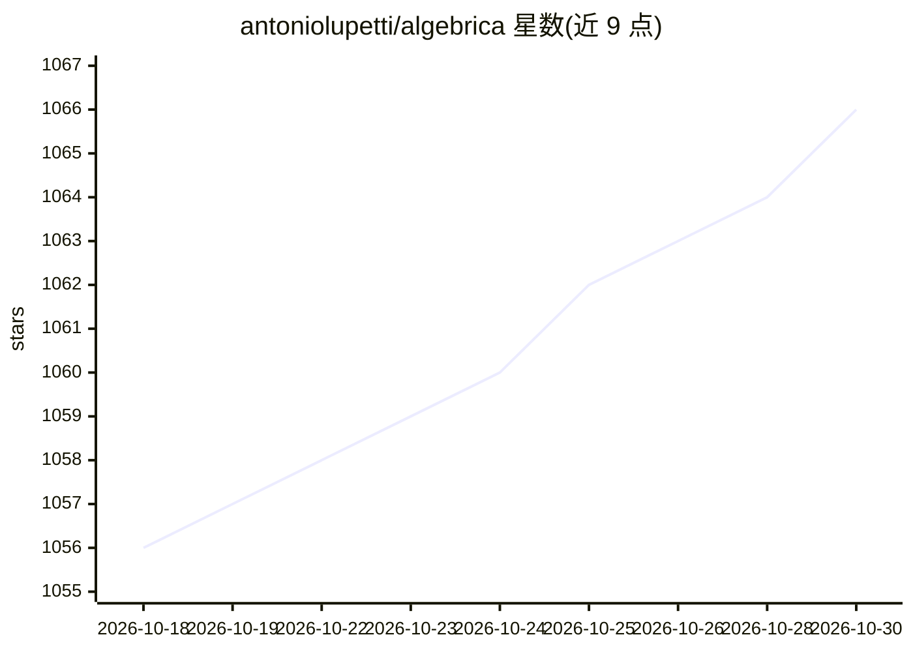

# antoniolupetti/algebrica

⭐ 1,066 · NOASSERTION · 推送 2026-10-23 · [GitHub](https://github.com/antoniolupetti/algebrica) · [官网](https://algebrica.org) · 个人维护

**大学级数学知识库：手写条目+语义层开源内容**

Antonio Lupetti 自 2023 年起手工撰写并审校的大学级数学知识库（algebrica.org），本仓库托管其条目源文件：Markdown/LaTeX 原文、可编辑 SVG 插图、含定义/引理/定理等形式的语义 JSON 层，以及 Markdown 流程图。截至 2026 年 9 月约含 300 条目，作者正系统修订既有条目。计划完成本体模型与交互式语义图。内容采用 CC BY-NC 4.0 非商业许可。AI 工具（Grammarly、Codex、Claude Cowork）仅用于润色、内部链接与查错，数学内容由作者本人撰写并逐条核实。

## 筛选速览

| 维度 | 判定 | 备注 |
|---|---|---|
| AI 角色 | `ai-knowledge` | 知识聚合/清单类 |
| 许可风险 | `none` | NOASSERTION |
| 部署形态 | `None` |  |
| 模型依赖 | — | README 未给出锁定关系 |
| 硬件要求 | — | 无带数字的原话,不猜 |
| 安装摩擦 | `low` | 无编译、无系统依赖或容器化 |
| 成熟度 | — | 结构信号不足 |

## 能力要点

- 条目 Markdown/LaTeX 源文件与可编辑 SVG 插图开源发布
- 语义 JSON 层包含定义、性质、引理、定理等形式化结构
- Markdown 流程图描述数学过程与解题方法的主要步骤
- 计划建设本体模型与交互式语义图以支持概念探索

## 适用场景

- 查阅结构化、经过审校的大学级数学条目
- 复用语义 JSON 层与 SVG 插图做非商业教育用途
- 追踪数学概念间关系的语义图（规划中）

## 场景标签

`知识库管理` `教程课程` · 领域:知识与检索

## 证据(README 行号)

> L17: Algebrica is a free, ad-free, university-level mathematics knowledge base. This repository hosts the source content
> L23: - a semantic JSON layer containing definitions, properties, lemmas, theorems, and other formal mathematical structu

## 星数曲线

2026-10-18 1,056 → 2026-10-30 1,066（+10）

---
*卡片 v1 · prompt 1.4 · 生成 2026-10-21 · 置信度 high · 依据 README sha `c70a9e69991e` · [字段定义](../../DATASET.md)*
