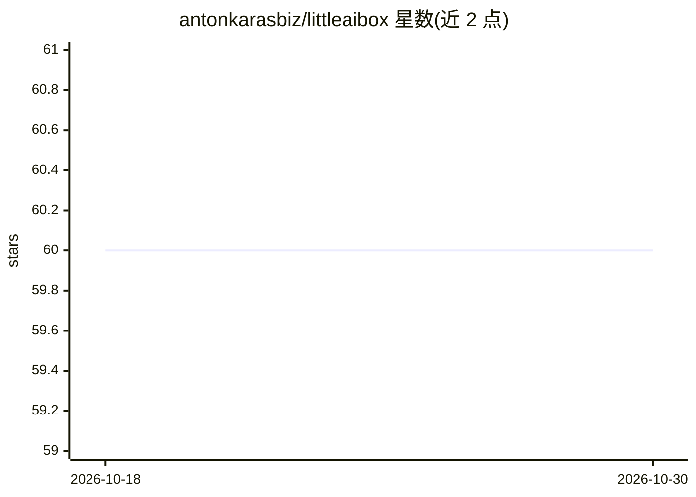

# antonkarasbiz/littleaibox

⭐ 60 · JavaScript · MIT · 推送 2026-09-13 · [GitHub](https://github.com/antonkarasbiz/littleaibox) · [官网](https://littleaibox.com) · 个人维护

**注重隐私的 AI 对话平台：自带密钥、本地保存文件与历史**

面向终端用户的 AI 对话应用：支持通用问答、编程、写作、翻译与研究任务，提供 Mermaid/LaTeX/Vega-Lite 渲染、任务预设与时间线。用户自带 API 密钥，客户端解析 PDF/DOCX/PPTX/XLSX，对话状态存于 IndexedDB；附带 Gemini 兼容 API 的池化与中继层，支持双密钥健康检查与故障切换。以 Web 应用、PWA 与 Capacitor 打包的 Android 版交付，可选联网搜索与 Semantic Scholar 研究模式。MIT 许可。

## 筛选速览

| 维度 | 判定 | 备注 |
|---|---|---|
| AI 角色 | `ai-native` | 本体是模型或模型工具 |
| 许可风险 | `permissive` | MIT |
| 部署形态 | `library` | 以包/库形式分发 |
| 模型依赖 | — | README 未给出锁定关系 |
| 硬件要求 | — | 无带数字的原话,不猜 |
| 安装摩擦 | `low` | 无编译、无系统依赖或容器化 |
| 成熟度 | — | 结构信号不足 |

## 能力要点

- 客户端解析 PDF/DOCX/PPTX/XLSX，对话状态存 IndexedDB
- 双 API 密钥管理与健康检查、故障切换
- PWA 离线支持与 Capacitor Android 打包
- 可选 Web 搜索与 Semantic Scholar 研究模式

## 适用场景

- 不上传工作区即获得文件感知的编程辅助
- 浏览器内分析论文与幻灯片
- 受限网络环境下通过中继/池化访问模型
- 隐私敏感团队本地保存文件与对话历史

## 场景标签

`AI 助手` `文档问答` · 领域:对话与助手

## 证据(README 行号)

> L7: LittleAIBox is an applied-AI product: a Gemini-compatible conversation surface plus an API pooling and relay layer f
> L13: - Conversational AI for general, coding, and research tasks

## 星数曲线

2026-10-18 60 → 2026-10-30 60（+0）

---
*卡片 v1 · prompt 1.4 · 生成 2026-10-24 · 置信度 high · 依据 README sha `cc48ce561a30` · [字段定义](../../DATASET.md)*
