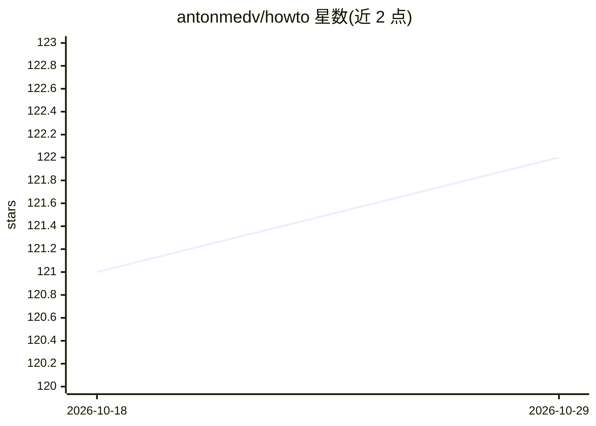

# antonmedv/howto

⭐ 122 · Go · MIT · 推送 2026-01-29 · [GitHub](https://github.com/antonmedv/howto) · 个人维护

**终端助手：按键调用 LLM 生成并填入正确命令**

Go 编写的终端辅助工具：用户在 shell 中写下不完整或错误的命令后按 ctrl+g，howto 将当前命令发送给 LLM，并把返回的正确命令插入当前终端输入，用户可在执行前修改。支持 OpenAI、Gemini、DeepSeek 三家 API（自动检测，均走 OpenAI 兼容格式），可通过环境变量覆盖默认模型。安装方式为 go install 或下载预编译二进制，需自行配置 zsh 等按键绑定与 API key。

## 筛选速览

| 维度 | 判定 | 备注 |
|---|---|---|
| AI 角色 | `ai-native` | 本体是模型或模型工具 |
| 许可风险 | `permissive` | MIT |
| 部署形态 | `library` | 以包/库形式分发 |
| 模型依赖 | locked-api |  |
| 硬件要求 | — | 无带数字的原话,不猜 |
| 安装摩擦 | `low` | 无编译、无系统依赖或容器化 |
| 成熟度 | — | 结构信号不足 |

## 能力要点

- ctrl+g 将当前命令发给 LLM 并以返回命令替换输入
- 支持 OpenAI、Gemini、DeepSeek，自动按优先级检测 API key
- 可从历史命令回溯并调整提示词
- 提供 go install 与预编译二进制两种安装途径

## 适用场景

- 忘记命令语法时快速生成正确命令
- 把复杂操作（如转换视频格式、列出容器主机名）交给 LLM 写命令
- 在执行前检查并修改 LLM 返回的命令

## 场景标签

`代码生成` · 领域:编码与开发

## 证据(README 行号)

> L5: **Howto** is a terminal helper which queries LLM and inserts the result into the current terminal input.
> L9: Simply press ctrl + g to call **howto**. **Howto** replaces your command with a correct command from LLM.

## 星数曲线

2026-10-18 121 → 2026-10-29 122（+1）

---
*卡片 v1 · prompt 1.4 · 生成 2026-10-23 · 置信度 high · 依据 README sha `3e9597447ed6` · [字段定义](../../DATASET.md)*
