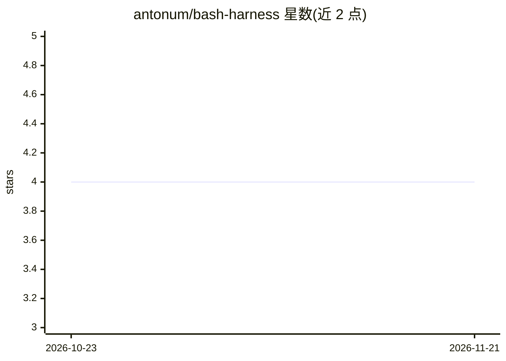

# antonum/bash-harness

⭐ 4 · Python · MIT · 推送 2026-10-19 · [GitHub](https://github.com/antonum/bash-harness) · [官网](https://dev.to/antonum/minimalistic-ai-harness-in-62-lines-of-bash-script-170m) · 个人维护

**用 bash/curl/jq 构建 AI 编码 agent 的分步教程**

由编号脚本组成的教程仓库，每步在前一脚本基础上新增一个概念：从单次 chat completions 调用、带 JSON 会话数组的对话循环，到让模型请求执行 shell 命令并把结果回喂的工具调用 harness。附带 harness 生成的 tetris.py 示例与长文说明（ARTICLE.md/dev.to）。需终端中已有 bash/curl/jq 与 OpenRouter API key 或其他支持工具调用的 OpenAI 兼容端点。README 明确警告 harness 会以用户权限无确认执行模型请求的命令。

## 筛选速览

| 维度 | 判定 | 备注 |
|---|---|---|
| AI 角色 | `ai-knowledge` | 知识聚合/清单类 |
| 许可风险 | `permissive` | MIT |
| 部署形态 | `None` |  |
| 模型依赖 | locked-api |  |
| 硬件要求 | — | 无带数字的原话,不猜 |
| 安装摩擦 | `low` | 无编译、无系统依赖或容器化 |
| 成熟度 | — | 结构信号不足 |

## 能力要点

- 3 个递进脚本：LLM 调用 → 对话循环 → 工具调用 harness
- 兼容任何支持 tool calling 的 OpenAI 端点，含本地模型
- 附带由 harness 生成的 tetris.py 可运行示例

## 适用场景

- 学习 agent 工具调用循环的底层实现原理
- 在最小依赖环境下演示 LLM 编写并运行程序
- 以此为起点改造自己的 shell 版编码 agent

## 场景标签

`编码 Agent` `教程课程` · 领域:编码与开发

## 证据(README 行号)

> L3: A tutorial on building an agentic harness in nothing but `bash`, `curl` and `jq`.
> L4: Each numbered script adds one idea on top of the previous one. The full

## 星数曲线

2026-10-23 4 → 2026-11-21 4（+0）

---
*卡片 v1 · prompt 1.4 · 生成 2026-11-21 · 置信度 high · 依据 README sha `1cb199af7560` · [字段定义](../../DATASET.md)*
