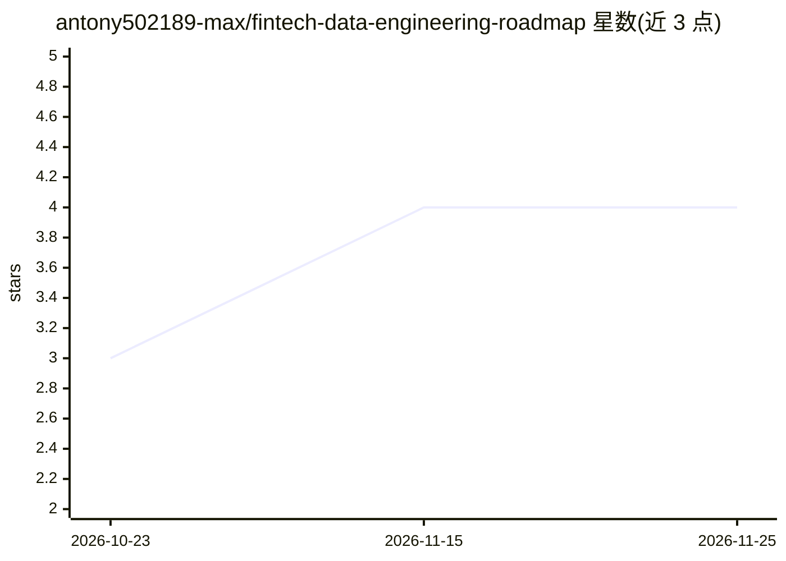

# antony502189-max/fintech-data-engineering-roadmap

⭐ 4 · Python · MIT · 推送 2026-10-22 · [GitHub](https://github.com/antony502189-max/fintech-data-engineering-roadmap) · 个人维护

**金融数据工程学习路线：100 课+40 练习+8 场景实验**

开源的金融科技数据工程学习路径，覆盖数据仓库、账务金额、变更历史、幂等投递、对账与恢复等主题，含 100 课、40 道基础练习、8 个场景实验与 4 个结业项目。练习使用合成支付数据，核心实验仅需 Python 3.12+ 标准库与 SQLite，无需付费云服务或 API key。自带评分 CLI、可运行演示与 92 个验证用例，模块另涉及 CDC、dbt、Kafka、AI 助手、RAG 与 Text-to-SQL 等主题。

## 筛选速览

| 维度 | 判定 | 备注 |
|---|---|---|
| AI 角色 | `ai-knowledge` | 知识聚合/清单类 |
| 许可风险 | `permissive` | MIT |
| 部署形态 | `None` |  |
| 模型依赖 | — | README 未给出锁定关系 |
| 硬件要求 | — | 无带数字的原话,不猜 |
| 安装摩擦 | `low` | 无编译、无系统依赖或容器化 |
| 成熟度 | — | 结构信号不足 |

## 能力要点

- 100 课学习路线，10 个模块按主题组织
- 40 道练习带参考答案、92 个验证用例与评分 CLI
- 8 个场景实验含多批次回滚、双时态报表、备份恢复等
- AI 模块覆盖 RAG 权限、注入、评估与特征工程

## 适用场景

- 按路线自学金融领域的数据工程与数仓建模
- 用评分 CLI 逐题练习 SQL、CDC 与对账实现
- 为初级或转型数据工程师挑选入门学习路径

## 场景标签

`教程课程` `金融量化` · 领域:学习与行业

## 证据(README 行号)

> L9: An open learning path for data engineering, DWH, and financial data. Learn what to study, why it matters, how to imp
> L58: |100 lessons|Concepts, fintech examples, implementation steps, tasks, failure modes, acceptance checks, and primary
> L70: |Module|Focus|Practice|

## 星数曲线

2026-10-23 3 → 2026-11-25 4（+1）

---
*卡片 v1 · prompt 1.4 · 生成 2026-11-21 · 置信度 high · 依据 README sha `96fe5398aee1` · [字段定义](../../DATASET.md)*
