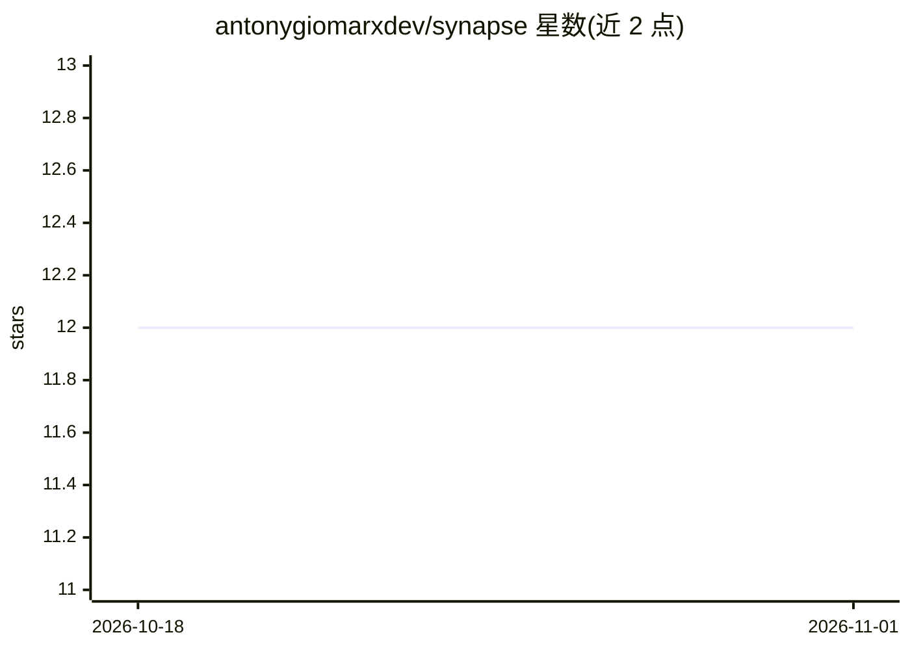

# antonygiomarxdev/synapse

⭐ 12 · Rust · Apache-2.0 · 推送 2026-10-03 · [GitHub](https://github.com/antonygiomarxdev/synapse) · 个人维护

**面向消费级 GPU 的 MoE 模型分布式推理基础设施**

Rust 编写的 Mixture-of-Experts 推理基础设施：将专家分片（expert sharding）分布到多台消费级硬件上，由协调节点本地运行注意力并将专家 FFN 分发给远程 worker，从 GGUF 文件按需加载专家。提供两种网络模式：面向交互的 Speculative Network（多节点多数投票）与面向批处理的 Network DAG。网关以 axum 提供 /v1/jobs 异步推理 API，推理运行时含 vLLM、Ollama、Mock 后端。V0 已完成，声称分布式专家推理与单体执行结果一致；安装需从源码 cargo build。

## 筛选速览

| 维度 | 判定 | 备注 |
|---|---|---|
| AI 角色 | `ai-ecosystem` | LLM/agent 周边工具 |
| 许可风险 | `permissive` | Apache-2.0 |
| 部署形态 | `None` |  |
| 模型依赖 | local-ok | 支持本地模型 |
| 硬件要求 | — | 无带数字的原话,不猜 |
| 安装摩擦 | `medium` | 含编译或系统依赖之一 |
| 成熟度 | `idea` | |

## 能力要点

- 专家分片：worker 仅从 GGUF 加载被分配的专家
- 两种网络模式：Speculative Network（实时投票）与 Network DAG（批处理流水线）
- 异步任务 API（POST/GET /v1/jobs）与崩溃恢复重试机制
- Rust 网关 + Python 推理后端（vLLM/Ollama/Mock）

## 适用场景

- 在自有消费级 GPU 上运行 Qwen2.5-MoE、Mixtral 等大模型
- 科研或小团队做批量推理、数据集处理、评测流水线
- 多节点分布式部署 MoE 模型并容忍 worker 故障

## 场景标签

`推理引擎` · 领域:训练与推理

## 证据(README 行号)

> L10: **Distributed inference infrastructure for Mixture-of-Experts models.**
> L18: Synapse is built specifically for MoE. It handles expert sharding and routing at the infrastructure level — distrib
> L143: |Inference runtime|Python|vLLM, Ollama, Mock backends|

## 星数曲线

2026-10-18 12 → 2026-11-01 12（+0）

---
*卡片 v1 · prompt 1.4 · 生成 2026-11-01 · 置信度 high · 依据 README sha `d522d125e871` · [字段定义](../../DATASET.md)*
