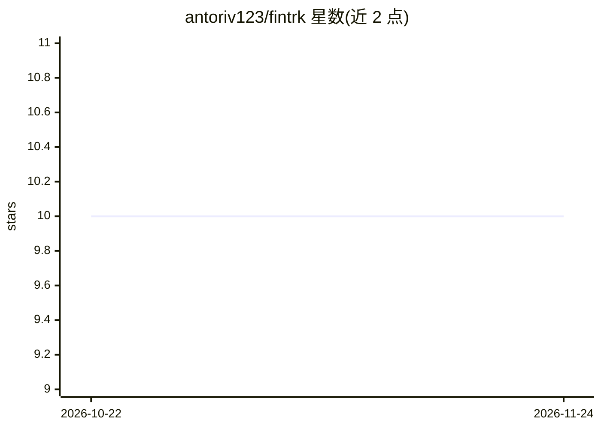

# antoriv123/fintrk

⭐ 10 · TypeScript · MIT · 推送 2026-08-18 · [GitHub](https://github.com/antoriv123/fintrk) · [官网](https://fintrk.app) · 个人维护

**可自托管的个人记账应用，AI 自动归类交易**

基于 Next.js 16 + PostgreSQL 的自托管个人财务应用：导入 100+ 银行的 PDF/CSV/XLSX 对账单并自动识别格式，用 OpenAI GPT-4o-mini 对每笔交易做 AI 分类；提供多账户与转账、周期交易/固定支出检测、预算与储蓄目标、信封预算法、净值追踪，以及基于 Yahoo Finance 数据的股票组合视图；支持 PWA 离线外壳，数据存于用户自己的 PostgreSQL，可部署到 Vercel，需配置 OPENAI_API_KEY 等环境变量。

## 筛选速览

| 维度 | 判定 | 备注 |
|---|---|---|
| AI 角色 | `ai-enhanced` | 去掉 AI 部分产品仍成立 |
| 许可风险 | `permissive` | MIT |
| 部署形态 | `library` | 以包/库形式分发 |
| 模型依赖 | — | README 未给出锁定关系 |
| 硬件要求 | — | 无带数字的原话,不猜 |
| 安装摩擦 | `low` | 无编译、无系统依赖或容器化 |
| 成熟度 | — | 结构信号不足 |

## 能力要点

- PDF/CSV/XLSX 对账单导入，覆盖 100+ 银行并自动识别格式
- OpenAI GPT-4o-mini 驱动的交易自动分类（vision + text）
- 预算/储蓄目标/信封预算/净值追踪与多账户转账
- PWA 离线外壳，单文件 SQL schema（约 24 张表，无 ORM）

## 适用场景

- 自托管记录和分析个人收支与预算
- 批量导入银行对账单并自动归类交易
- 跟踪储蓄目标、净值与股票持仓

## 场景标签

`文档解析` · 领域:知识与检索

## 证据(README 行号)

> L10: Self-hosted personal finance app built on Next.js 16 + PostgreSQL + OpenAI. MIT-licensed.
> L15: - AI categorization of transactions (OpenAI GPT-4o-mini)

## 星数曲线

2026-10-22 10 → 2026-11-24 10（+0）

---
*卡片 v1 · prompt 1.4 · 生成 2026-11-20 · 置信度 high · 依据 README sha `dbcd62e32bb8` · [字段定义](../../DATASET.md)*
