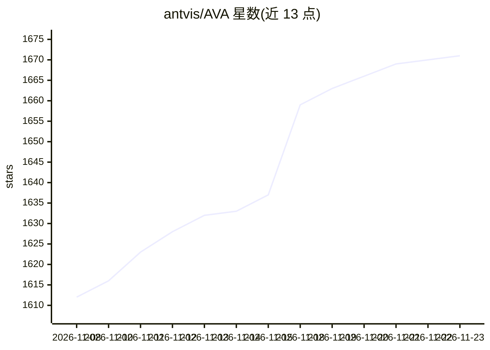

# antvis/AVA

⭐ 1,671 · TypeScript · MIT · 推送 2026-11-19 · [GitHub](https://github.com/antvis/AVA) · [官网](https://ava.antv.vision) · 组织维护 · 中文 README

**面向 AI Agent 的 JavaScript 可视化数据分析框架**

AVA 是一个 AI-native 的可视化分析技术框架，提供数据接入、schema 检查、数据画像、语义定义、问题建议、分析与图表生成的完整工作流，SQL 与结果可核查。支持 CSV/JSON/Parquet/Excel 及多种数据库数据源，可本地执行并自选模型端点。定位为 JavaScript 版 PandasAI，供应用与 AI Agent 集成，也可经 CLI 在终端使用，并提供 npx 安装的 Agent skill。

## 筛选速览

| 维度 | 判定 | 备注 |
|---|---|---|
| AI 角色 | `ai-ecosystem` | LLM/agent 周边工具 |
| 许可风险 | `permissive` | MIT |
| 部署形态 | `library` | 以包/库形式分发 |
| 模型依赖 | — | README 未给出锁定关系 |
| 硬件要求 | — | 无带数字的原话,不猜 |
| 安装摩擦 | `low` | 无编译、无系统依赖或容器化 |
| 成熟度 | — | 结构信号不足 |

## 能力要点

- 数据接入→画像→语义→建议→分析→可视化的完整工作流，SQL 与结果可核查
- 多数据源联合查询：文件与数据库在同一查询中连接
- 本地执行，可指定分析运行位置与模型端点
- 提供 npx skills add 安装的 Agent skill 与 CLI 使用方式

## 适用场景

- 在应用中集成自然语言数据分析与图表生成能力
- 让 AI Agent 通过 AVA 执行数据工作流
- 从 CSV 或数据库文件出发做探索性数据分析
- 在浏览器环境试用 AI 数据分析

## 场景标签

`数据分析` · 领域:效率与自动化

## 证据(README 行号)

> L25: AVA (AVA examples Visual Analytics) is a technology framework designed for more convenient visual analytics. **A** 
> L32: > **Think of AVA as PandasAI for JavaScript. 💬📊🤖**
> L59:  Your agent reasons; AVA executes the data workflow.

## 星数曲线

2026-11-08 1,612 → 2026-11-23 1,671（+59）

---
*卡片 v1 · prompt 1.4 · 生成 2026-11-23 · 置信度 high · 依据 README sha `8bb831c2698c` · [字段定义](../../DATASET.md)*
