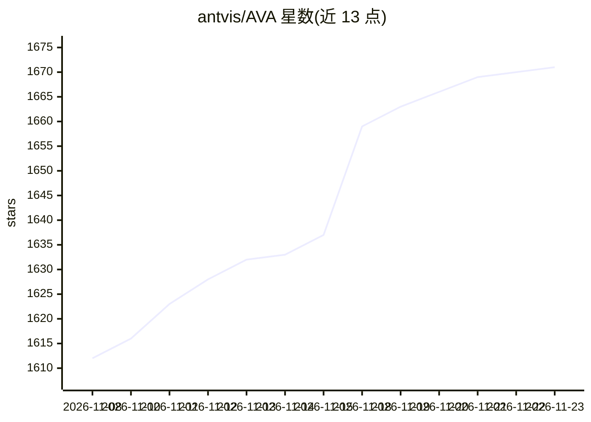

# antvis/AVA

⭐ 1,671 · TypeScript · MIT · 推送 2026-11-19 · [GitHub](https://github.com/antvis/AVA) · [官网](https://ava.antv.vision) · 组织维护 · 中文 README

**面向 Agent 的 JavaScript 自然语言数据分析与可视化框架**

AntV 维护的 TypeScript/Node.js 框架，README 自称 "JavaScript 版 PandasAI"，把自然语言数据分析与可视化带入应用和 AI Agent。工作流覆盖数据接入、schema 检查、profiling、语义定义、分析（生成可验证 SQL 与结果）与图表生成（由 GPT-Vis 驱动）。支持 CSV/JSON/Parquet/Excel 及 MySQL/PostgreSQL/MongoDB/Snowflake 等多种数据源联合查询，分析可本地执行并自选模型端点；提供 DataBench 与 Spider2-Lite 评测结果。以 npm 包、CLI 和 Agent skill（npx skills add）三种方式使用。

## 筛选速览

| 维度 | 判定 | 备注 |
|---|---|---|
| AI 角色 | `ai-native` | 本体是模型或模型工具 |
| 许可风险 | `permissive` | MIT |
| 部署形态 | `library` | 以包/库形式分发 |
| 模型依赖 | — | README 未给出锁定关系 |
| 硬件要求 | — | 无带数字的原话,不猜 |
| 安装摩擦 | `low` | 无编译、无系统依赖或容器化 |
| 成熟度 | — | 结构信号不足 |

## 能力要点

- 单条查询内连接文件与多种数据库数据源
- 分析产出可检验的 SQL 与结果（grounded answers）
- 自然语言驱动的问题建议、分析与图表生成
- 提供 npm 库、CLI 与 Agent skill 三种使用方式

## 适用场景

- 在应用中用自然语言做数据探索与出图
- 为 AI Agent 提供可执行的数据分析工作流
- 在终端直接加载 CSV 并提问分析

## 场景标签

`数据分析` · 领域:效率与自动化

## 证据(README 行号)

> L32: > **Think of AVA as PandasAI for JavaScript. 💬📊🤖**
> L34: > It brings natural-language data analysis and visualization to your apps and AI agents.
> L59:  Your agent reasons; AVA executes the data workflow.

## 星数曲线

2026-11-08 1,612 → 2026-11-23 1,671（+59）

---
*卡片 v1 · prompt 1.4 · 生成 2026-11-17 · 置信度 mid · 依据 README sha `36f20e0a592d` · [字段定义](../../DATASET.md)*
